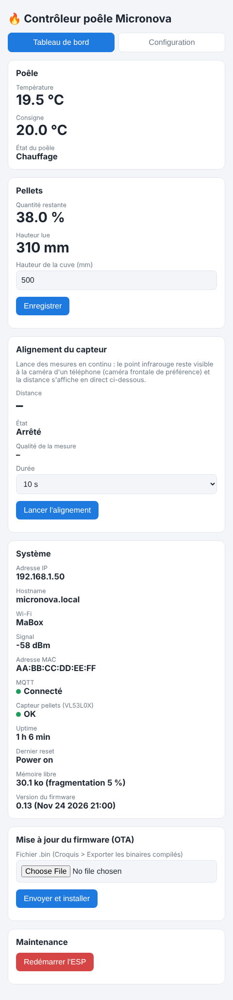
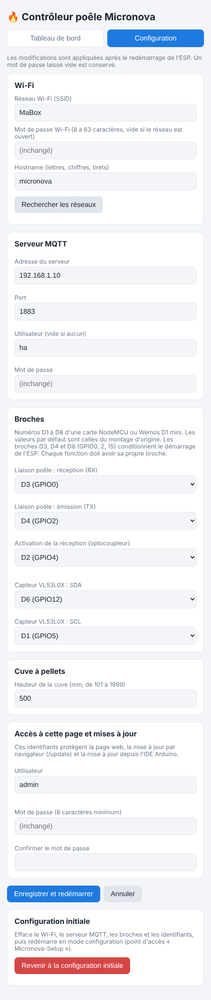
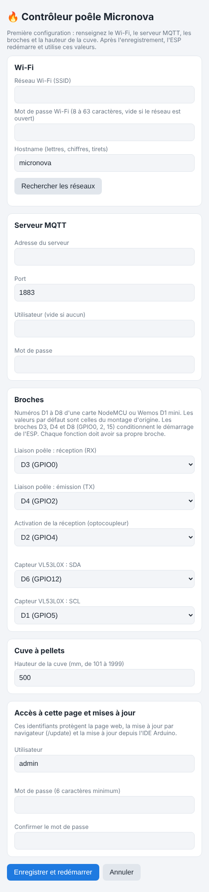
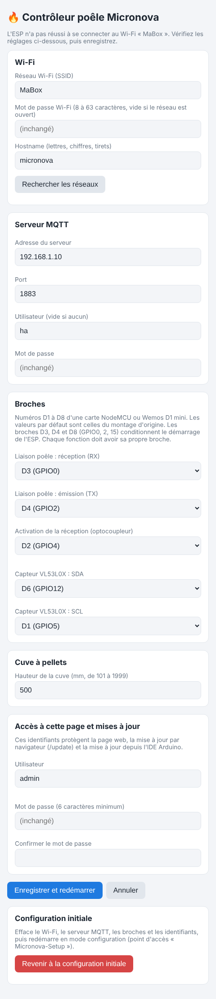

# Micronova Pellet Stove Controller (ESP8266) — Technical Documentation

> ESP8266 firmware that bridges a Micronova pellet stove and Home Assistant over MQTT: stove control, pellet hopper level measurement, MQTT autodiscovery, web configuration page and OTA updates.

This document describes the firmware **version 0.14** (`botero2_Nov25_hostname.ino`).

## Table of contents

1. [Project overview](#1-project-overview)
2. [Serial communication](#2-serial-communication)
3. [Read and write logic](#3-read-and-write-logic)
4. [Functions and their usage](#4-functions-and-their-usage)
5. [Focus: MQTT autodiscovery](#5-focus-mqtt-autodiscovery)
6. [Appendix: known issues](#6-appendix-known-issues)
7. [Version history](#7-version-history)

---

## 1. Project overview

### Purpose

This firmware turns an ESP8266 into a gateway between a **pellet stove fitted with a Micronova board** and **Home Assistant** (HA). It can:

- read the stove state (off, ignition, heating, alarm…), the ambient temperature, the power level and the temperature setpoint;
- control the stove (on, off, standby, power level, temperature setpoint);
- measure the pellet level in the hopper with a VL53L0X distance sensor;
- help position that sensor in the hopper (alignment mode: infrared emitted continuously, distance shown live);
- tell HA that it is alive and that the pellet sensor works (MQTT heartbeat), so that a failure can be detected, and report its IP address;
- declare all its sensors and controls to HA automatically (MQTT discovery);
- be configured without touching the code: on first start, a web page (Wi-Fi access point "Micronova-Setup") lets you enter the Wi-Fi, the MQTT server, the pins, the hopper height and, optionally, an account to access the web page, then the ESP restarts with these values;
- be changed later from the same interface (Configuration tab) and updated without a cable (web page, OTA).

### Architecture

```
 ┌──────────────┐  serial, 1200 baud  ┌─────────────┐   Wi-Fi / MQTT   ┌──────────────┐
 │ Micronova    │◄───────────────────►│  ESP8266    │◄────────────────►│ MQTT broker  │
 │ stove board  │   (optocoupler)     │ (this code) │                  │ + Home       │
 │              │                     │             │   HTTP (80)      │ Assistant    │
 └──────────────┘                     │  VL53L0X ───┤◄────────────────►│ web browser  │
                                      │  (I²C)      │   OTA            └──────────────┘
                                      └─────────────┘
```

### Hardware and pinout

The pins are **entered on the configuration page** (see 3.7) and kept in EEPROM. The default values, those of the original wiring, are pre-filled in the form:

| Function                | Default pin | GPIO | Variable      |
|-------------------------|-------------|------|---------------|
| Stove link, receive     | D3          | 0    | `pinRx`       |
| Stove link, transmit    | D4          | 2    | `pinTx`       |
| Receive enable          | D2          | 4    | `pinEnableRx` |
| I²C SDA (VL53L0X)       | D6          | 12   | `pinSda`      |
| I²C SCL (VL53L0X)       | D1          | 5    | `pinScl`      |

The possible choices are D1 to D8 of a NodeMCU or Wemos D1 mini board (GPIO 0, 2, 4, 5, 12, 13, 14, 15), with five different pins. GPIO16 (D0) is excluded: it has no interrupt, so it suits neither the software serial link nor I²C. Pins D3, D4 and D8 (GPIO 0, 2, 15) determine how the ESP boots.


### Libraries

`ESP8266WiFi`, `DNSServer` (captive portal of the configuration mode), `PubSubClient` (MQTT), `SoftwareSerial` (stove link), `Wire` and `Adafruit_VL53L0X` (sensor), `ESP8266WebServer` and `ESP8266HTTPUpdateServer` (web page and browser updates), `ArduinoOTA` (updates from the IDE), `EEPROM` (hostname, hopper height, configuration).

### Files

| File                            | Role                                                              |
|---------------------------------|-------------------------------------------------------------------|
| `botero2_Nov25_hostname.ino`    | The firmware: **the only file needed to build**                   |
| `DOCUMENTATION.md`, `DOCUMENTATION.en.md` | This documentation, in French and in English            |

Since version 0.12, there is no `secrets.h` or `secrets.example.h` any more: the Wi-Fi, MQTT, pins and credentials are entered on the configuration page and kept in EEPROM, not in the code.


### Runtime cycle

1. **Startup** (`setup`): read the hostname, the hopper height and the configuration from EEPROM. Without a configuration, the ESP opens the "Micronova-Setup" access point and its configuration page, then waits (see 3.7). Otherwise: initialize the pins, connect to Wi-Fi (falling back to the access point if it fails), start the web server and OTA, connect to MQTT, publish the autodiscovery messages, subscribe to commands, initialize the VL53L0X sensor, publish a first heartbeat.
2. **Loop** (`loop`), continuously: keep the MQTT connection alive, process incoming messages (commands), serve web and OTA requests, take continuous measurements if the alignment mode is active (`alignTick`).
3. **Every 60 seconds**: poll the stove and the sensor (`getStates`), evaluate the sensor health (`updateSensorHealth`), publish the heartbeat and the IP address (`publishHeartbeat`) and an alive message (`pong`). After more than 10 failed distance measurements in a row, the ESP restarts.

---

## 2. Serial communication

### Parameters

| Parameter        | Value                                                      |
|------------------|------------------------------------------------------------|
| Baud rate        | 1200                                                       |
| Frame format     | 8 data bits, no parity, **2 stop bits** (`SWSERIAL_8N2`)   |
| Implementation   | `SoftwareSerial` (`StoveSerial`), 256-byte buffer          |
| Pins             | RX = D3, TX = D4 by default (configurable, see 3.7)        |

The ESP8266 has a single hardware serial port, kept for debugging (`Serial`, 115200 baud). The link to the stove therefore uses a software serial port on two configurable pins (D3 and D4 by default).

### The `ENABLE_RX` pin (D2 by default)

According to the code comments, this pin drives the LED of an optocoupler: when `HIGH`, the LED is off and reception is blocked. It is `HIGH` by default (at startup and after each read). It goes `LOW` right after a read request is sent, to let the stove's answer through, and returns to `HIGH` inside `checkStoveReply()`.

### The protocol

The link is **request / response**: the stove only talks when it is queried.

**Read: 2 bytes sent, 2 bytes received**

```
ESP → stove:  [read code] [address]
stove → ESP:  [checksum]  [value]
```

- The read code is `0x00` for RAM (`_RAMR`) or `0x20` for EEPROM (`_EEPROMR`).
- The checksum of the answer is `code + address + value` (8-bit).

Example, reading the ambient temperature (RAM `0x01`), answer for 19.5 °C (value 39 = `0x27`):

```
ESP → stove:  00 01
stove → ESP:  28 27        (0x28 = 0x00 + 0x01 + 0x27)
```

**Write: 4 bytes sent, no answer read**

```
ESP → stove:  [write code] [address] [value] [checksum]
```

- The write code is `0x80` for RAM (`_RAMW`) or `0xA0` for EEPROM (`_EEPROMW`).
- The checksum is `code + address + value`, truncated to 8 bits (`(char)(…)` in the code).

Example, setting the setpoint to 19 °C. The stove stores the value ×2, so 38 = `0x26` at EEPROM address `0x6B`:

```
ESP → stove:  A0 6B 26 31   (0xA0 + 0x6B + 0x26 = 0x131, truncated to 0x31)
```

The code does not read any acknowledgement after a write. It simply waits 2 seconds (or re-reads the states) to see the result.

### Memory map in use

**RAM (read side)**

| Address | Constant         | Content                                   | Unit / conversion        |
|---------|------------------|-------------------------------------------|--------------------------|
| `0x01`  | `ambTempAddr`    | Ambient temperature                       | value ÷ 2 = °C           |
| `0x03`  | `stovePwrAddr`   | Actual power level                        | 1 = Eco, 2 to 6 = P1 to P5 |
| `0x09`  | `blowTempAddr`   | Blow (outlet air) temperature             | raw                      |
| `0x21`  | `stoveStateAddr` | Stove state (written to switch on, off, standby) | code 0 to 13      |
| `0x37`  | `extractorAddr`  | Extractor speed                           | raw                      |
| `0x59`  | `blowSpeedAddr`  | Blower speed                              | raw                      |
| `0x5C`  | `fumeTempAddr`   | Flue gas temperature                      | raw                      |
| `0x63`  | `visPelletAddr`  | Pellet auger speed                        | raw                      |
| `0x75`  | `fixVacuumAddr`  | Fixed vacuum (draft)                      | raw                      |
| `0x76`  | `readVacuumAddr` | Measured vacuum (draft)                   | raw                      |
| `0x77`  | `multVacuumAddr` | Vacuum multiplier                         | raw                      |
| `0x9A`  | `cardTempAddr`   | Board temperature                         | value ÷ 2 = °C           |

**Stove EEPROM (read and write)**

| Address | Constant      | Content              | Note                          |
|---------|---------------|----------------------|-------------------------------|
| `0x6B`  | `tempSetAddr` | Temperature setpoint | stored value = °C × 2         |
| `0xD0`  | `pwrSetAddr`  | Power setpoint       | 0 to 5                        |

**Stove state codes (RAM `0x21`)**

| Code | State                    | Code | State                      |
|------|--------------------------|------|----------------------------|
| 0    | Off                      | 7    | Heating                    |
| 1    | Initial ventilation      | 8    | Burn pot cleaning          |
| 2    | Resistance preheating    | 9    | Final cleaning             |
| 3    | Pellet preloading        | 10   | Waiting for standby        |
| 4    | Waiting for flame        | 11   | Standby                    |
| 5    | Waiting for ignition     | 12   | Pellet alarm               |
| 6    | Ignition                 | 13   | Alarm (to be investigated) |

### Predefined write frames

The frames are precomputed as constants, so nothing has to be recalculated:

| Constant                         | Frame            | Effect                       |
|----------------------------------|------------------|------------------------------|
| `stoveOn`                        | `80 21 01 A2`    | Switch on                    |
| `stoveStb`                       | `80 21 0B AC`    | Switch to standby            |
| `forceOff`                       | `80 21 00 A1`    | Switch off                   |
| `stovePWA`, `stovePW1`…`stovePW5`| `A0 D0 0n …`     | Set the power level (n = 0 to 5) |

---

## 3. Read and write logic

### 3.1 Reading

Every read follows the same sequence, in the `getXxx()` functions:

```
1. StoveSerial.write(read code)           // 0x00 (RAM) or 0x20 (EEPROM)
2. delay(1)
3. StoveSerial.write(address)
4. digitalWrite(pinEnableRx, LOW)           // opens reception
5. delay(80)                              // lets the stove answer
6. checkStoveReply()                      // reads and interprets the 2 bytes
```

**`checkStoveReply()`**:

1. Reads at most 2 bytes from the serial buffer (`stoveRxData[0]` = checksum, `[1]` = value).
2. Sets `pinEnableRx` back to `HIGH`.
3. If exactly 2 bytes were received, it **works out the address** from the answer with `param = checksum − value`. Since the checksum is `code + address + value`, `param` equals `code + address`: the address itself for a RAM read (code `0x00`), or `0x20 + address` for EEPROM.
4. A `switch (param)` routes the value to the right variable, applies the conversion (÷ 2 for temperatures) and **publishes it to MQTT** (retained).

Thanks to this, an answer does not have to be matched with the request that triggered it: it carries its own address.

| Received value (`param`)    | Variable     | MQTT topic published                                |
|-----------------------------|--------------|-----------------------------------------------------|
| `0x01`                      | `ambTemp`    | `micronova/ambtemp` (°C)                            |
| `0x03`                      | `stovePower` | `micronova/stovepower` (Eco, P1…P5)                 |
| `0x21`                      | `stoveState` | `micronova/stovestate` (text) and `micronova/onoff` |
| `0x6B + 0x20` (EEPROM)      | `tempSet`    | `micronova/tempset` (°C), `micronova/settemp` (select state) |
| `0xD0 + 0x20` (EEPROM)      | `pwrSet`     | `micronova/pwrset`                                  |
| `0x09`, `0x5C`, `0x9A`, `0x37`, `0x59`, `0x63`, `0x75`, `0x76`, `0x77` | various | `blowtemp`, `fumetemp`, `cardtemp`, `extractor`, `blowspeed`, `vispellet`, `fixvac`, `readvac`, `multvac` |

**Periodic cycle**: every 60 s, `getStates()` calls `getStovePower`, `getStoveState`, `getAmbTemp`, `getTempSet`, `getPowerSet`, then `getQte`. The other reads (flue gas, blower, auger, vacuum…) exist in the code but are not called automatically.

### 3.2 Writing (commands)

Commands arrive over MQTT on the topic **`micronova/cmd`**. The `callback()` function looks at the first character of the message to choose the action:

| Payload     | Action                    | Detail                                                                  |
|-------------|---------------------------|-------------------------------------------------------------------------|
| `ON`        | Switch on                 | Sends `stoveOn` if the state is 0 (off) or above 10                     |
| `ST`        | Standby                   | Sends `stoveStb` if the state is between 1 and 9                        |
| `OF…`       | Switch off                | Sends `forceOff` whatever the state                                     |
| `P0`…`P5`   | Power level               | Picks the frame `stovePWA`, `stovePW1`…`stovePW5`                       |
| `T<n>`      | Temperature setpoint      | `n` is read with `atof`, rounded, then written as is to EEPROM `0x6B`   |

**Key point about the setpoint**: the value sent in `T<n>` is the value **as the stove stores it**, i.e. the temperature × 2. Choosing 19 °C sends `T38`, 18.5 °C sends `T37`. The multiplication is done by the select's `command_template` in HA (`T{{ ((value | float) * 2) | int }}`). When reading, the firmware does the inverse (÷ 2) before publishing.

After a write, the firmware waits 2 seconds (`ON`, `ST`, `OF`, `P`) or 10 ms (`T`). For `ON`, `ST`, `OF` and `T`, it then calls `getStates()` to republish the real stove state; for `P`, that call is commented out in the code, so the new power level is only read back on the next cycle. For `ON`, `ST` and `OF`, it also immediately publishes a provisional state on `micronova/onoff` (`Marche`, `Attente`, `Eteint`).

### 3.3 Hopper level measurement

`getQte()` reads the VL53L0X, a distance sensor mounted above the pellets:

```
quantity (%) = (hopper_height − distance) / hopper_height × 100
```

- `hauteur_cuve` (hopper height) is 500 mm by default and can be set from the web page (101 to 1999 mm). Since version 0.10, the value is kept in EEPROM and read back at startup (see 3.5).
- A measurement is only taken **every 11 cycles** (about 11 minutes), using the `measure_sleep` counter.
- A distance above 1000 mm counts as an error (`count_reboot`) and sets `lastMeasureOk` to false. More than 10 consecutive failed measurements restart the ESP; a valid measurement resets the counter and sets `lastMeasureOk` back to true. An "out of range" sensor status (status 4) is only logged and does not count.
- If the sensor is not initialized (missing at startup, or gone from the I²C bus), `getQte()` does not attempt any measurement: it sets `lastMeasureOk` to false, logs it and returns (see 3.4).
- The distance is published on `micronova/distance` at every measurement. The quantity is only published on `micronova/qte` if it changed by at least 10 points since the last published value.

### 3.4 Heartbeat and sensor health

Since version 0.7, the firmware tells HA that it is alive and that the pellet sensor works. Because the quantity is only published when it changes by at least 10 points, its silence cannot be used to detect a failure: these two messages fill that gap.

| Topic                    | Content                                                    | Rate         |
|--------------------------|------------------------------------------------------------|--------------|
| `micronova/heartbeat`    | ESP uptime in seconds (`millis() / 1000`)                  | every 60 s   |
| `micronova/sensorstatus` | `ON` if the sensor is healthy, `OFF` otherwise             | every 60 s   |
| `micronova/ip`           | ESP IP address (for example `192.168.1.50`)                | every 60 s   |

The heartbeat and the sensor state are published **without the retain flag**: a retained message would be sent again to HA after its restart and would make it believe the ESP is alive. A first message is sent at the end of `setup()`, without waiting 60 s.

The **IP address** (added in version 0.8) is the exception: it is published **with the retain flag**. This way HA keeps the last known IP of the ESP even when it is switched off or unreachable, which is exactly when you need it to troubleshoot. It is republished every 60 s cycle, so an address change (new DHCP lease) is picked up in under a minute. It has no `expire_after`: this entity never becomes "unavailable" because of this topic.

The sensor state is computed by `updateSensorHealth()` every 60 s, right after `getStates()`:

```
sensorOk = sensor present on the I²C bus  AND  sensor initialized  AND  last measurement valid
```

- **Presence**: `sensorPresentI2C()` queries address `0x29` (the default VL53L0X address). A disconnected wire is therefore detected in under a minute, without taking a measurement.
- **Initialization**: the result of `lox.begin()` is kept in `sensorInitialized`. If the sensor disappears from the bus and comes back, `updateSensorHealth()` re-initializes it automatically (previously, a failed initialization was never retried without a restart).
- **Last measurement** (`lastMeasureOk`): becomes false on a distance above 1000 mm and true again on a valid measurement. Since a measurement is only taken every 11 cycles, an out-of-range reading can take up to 11 minutes to show up. The "out of range" status (status 4) does not change this state.

On the HA side, two entities use these topics (see section 5). They have an `expire_after` of 180 s: with no message for 3 minutes, they become "unavailable".

| State of the "Capteur pellets" entity | Meaning                                                      |
|---------------------------------------|--------------------------------------------------------------|
| `on`                                  | Everything is fine                                           |
| `off`                                 | The ESP answers, but the sensor is faulty                    |
| `unavailable`                         | No message for 3 minutes: ESP, Wi-Fi or MQTT is down         |

Example HA automation (check the entity ids in your installation; the 3-minute delay avoids false alerts when HA restarts, as the entities are briefly unavailable):

```yaml
alias: Micronova - pellet sensor fault
triggers:
  - trigger: state
    entity_id: binary_sensor.micronova_controller_capteur_pellets
    to:
      - "off"
      - unavailable
    for: "00:03:00"
actions:
  - action: notify.notify
    data:
      title: "Pellet stove"
      message: >
        {{ 'The Micronova controller no longer answers (ESP, Wi-Fi or MQTT).'
           if is_state('sensor.micronova_controller_heartbeat', 'unavailable')
           else 'The pellet level sensor is disconnected or returns out-of-range values.' }}
mode: single
```

### 3.5 Local storage (ESP EEPROM)

The EEPROM (432 bytes reserved) keeps the hostname, the hopper height and, since version 0.12, the whole configuration entered on the web page:

| Bytes    | Content                                                              |
|----------|----------------------------------------------------------------------|
| 0        | Marker `0xA5` (a hostname is stored)                                 |
| 1        | Hostname length (1 to 32)                                            |
| 2 to 33  | Hostname characters                                                  |
| 40       | Marker `0xB7` (a hopper height is stored)                            |
| 41       | Hopper height in mm, low byte                                        |
| 42       | Hopper height in mm, high byte                                       |
| 64 to 431 | Configuration (`StoredCfg` structure, marker `0xC0F10012`): Wi-Fi (network, password), MQTT server (address, port, user, password), the five pins (GPIO numbers), web user name and password (optional: empty when access to the page is open) |

Without a valid marker, or if the content is not a valid hostname, the default value `micronova` is used. In the same way, without a valid `0xB7` marker, or if the height is not between 101 and 1999 mm, the default value of 500 mm is kept. The height is only written when it has changed, to spare the flash.

Without the `0xC0F10012` marker, or if the Wi-Fi or the MQTT address are missing, the ESP considers it is not configured and opens the configuration portal. An invalid or duplicated pin in the structure is ignored: the original pins stay in use.

The web account is **optional**: with no web password stored (`webAuthEnabled()` false), the page, `/update` and OTA are open. Version 0.13 configurations, which always contain an account, stay valid as they are.

The passwords are stored **in clear text** in the ESP flash.


### 3.6 Sensor alignment mode

Since version 0.9, the web page offers an alignment mode to position the VL53L0X in the hopper. The sensor only emits its infrared light (940 nm) during a measurement: normally, that is a few milliseconds every 11 minutes, so nothing is visible. In alignment mode, the ESP measures continuously (about 20 times per second) for the chosen duration. The infrared dot becomes visible to a phone camera (the front camera, whose infrared filter is often weaker, works better), and the distance is shown live on the page.

- **Start**: `POST /align/start` with the duration in seconds. The page offers 10, 30, 60 or 120 s; accepted values range from 5 to 120 s, with 10 s by default. The request is refused (HTTP 503) if the sensor is not initialized.
- **How it works**: non-blocking. `alignTick()` is called on every pass of `loop()` and takes one measurement (`lox.rangingTest`) while the mode is active. MQTT, the web page and OTA keep answering.
- **End**: automatic when the time is up (log message `Align : mode alignement termine.`).
- **Live view**: the page reads `alignActive`, `alignRemain`, `alignDistance` and `alignStatus` from `/api/status`, every 0.5 s during the alignment. `alignStatus` is the VL53L0X status code: 0 = valid measurement, 4 = no return (target out of range, too dark or badly aimed), any other value = doubtful measurement, -1 = no measurement.
- **Scope of the measurements**: they are not published to MQTT and do not change `distance`, the quantity or `lastMeasureOk`.
- **Tip**: the beam is a cone of about 25°. Keep it clear of the hopper walls and lid; a distance that jumps around or a "no return" status means a bad alignment.

### 3.7 First configuration and later changes

Since version 0.12, no setting is written in the code: the Wi-Fi, the MQTT server, the pins, the hopper height and the web account (optional) are entered on the configuration page and kept in EEPROM (see 3.5).

**First start (no configuration stored)**

1. `setup()` finds no configuration (`cfgConfigured` is false) and calls `startPortal(true)`.
2. The ESP scans for Wi-Fi networks in range (list kept in cache), then opens the **`Micronova-Setup`** access point, open by default (constants `AP_SSID` and `AP_PASS`). A DNS server sends any address to the ESP (captive portal): on a phone, the page opens by itself, otherwise at `http://192.168.4.1`.
3. The web server only serves the page, limited to the Configuration tab, and the configuration routes, **without a password** since none exists yet (the web account is chosen in this same form). The stove, the sensor, MQTT and OTA are not started, and the pins are not touched.
4. The form is pre-filled: original pins, MQTT port 1883, hopper height 500 mm (or the value already stored), the stored hostname or `micronova`, web user `admin`. The "Protéger l'accès par un identifiant et un mot de passe" (protect access with a user name and password) checkbox is **ticked by default**; when unticked, the account fields disappear and a confirmation is asked on saving.
5. `POST /api/config` validates the values, stores them, then restarts the ESP after half a second. On the next start, `loadConfig()` reads these values back and the ESP runs normally.

**Validation rules**

| Field                           | Rule |
|---------------------------------|------|
| Wi-Fi network                   | 1 to 32 characters |
| Wi-Fi password                  | 8 to 63 characters, or empty for an open network |
| Hostname                        | 1 to 32 characters: letters, digits, hyphens, no hyphen at the start or the end |
| MQTT server                     | 1 to 64 characters, no space or "/" |
| MQTT port                       | 1 to 65535 |
| MQTT user, password             | At most 32 and 63 characters. Empty user: connection without authentication |
| Pins                            | D1 to D8 (GPIO 0, 2, 4, 5, 12, 13, 14, 15), five different pins |
| Hopper height                   | 101 to 1999 mm |
| Web user                        | Only if access is protected: 1 to 32 characters, no ":" |
| Web password                    | Only if access is protected: 6 to 63 characters |

When a configuration is already stored, an empty password field is **kept**: the web password while access stays protected, the Wi-Fi one as long as the network does not change, the MQTT one as long as the user does not change. Passwords are never sent back to the page (the form shows "(inchangé)", meaning unchanged).

**Wi-Fi unreachable (configuration present)**

- If the Wi-Fi connection does not succeed within 30 seconds (`WIFI_CONNECT_TIMEOUT_MS`), the ESP opens the same access point with `startPortal(false)`. This time, the page asks for the web user name and password (if an account was defined), and shows a message about the failed connection.
- With no activity on the page for 5 minutes (`PORTAL_RETRY_MS`), the ESP restarts to try the connection again. This covers a router still booting after a power cut. While the page is open, it queries the ESP every minute to avoid that restart in the middle of typing.
- The access point is only opened at startup: a Wi-Fi loss during operation is left to the ESP's automatic reconnection.

**MQTT server unreachable**

`reconnect_mqtt()` retries every 5 seconds. During the wait, the web page and OTA are still served: the MQTT address, port or credentials can therefore be corrected from the Configuration tab.

**Changing the configuration later**

When the ESP is connected, the **Configuration** tab of the main page offers the same form (pre-filled with the current values). "Enregistrer et redémarrer" (save and restart) applies the changes. "Annuler" (cancel) reloads the current values.

**Going back to the initial configuration**

The "Revenir à la configuration initiale" button (route `POST /config/reset`, protected by the web password, if there is one) erases the configuration (`clearConfig()`) and restarts: the ESP reopens the "Micronova-Setup" access point. The hostname and the hopper height are kept and pre-fill the form. If the web password is lost, the ESP has to be reflashed with a full flash erase (the "Erase Flash: All Flash Contents" option of the Arduino IDE).

---

## 4. Functions and their usage

### Startup and main loop

| Function       | Usage |
|----------------|-------|
| `setup()`      | Loads the hostname, the hopper height and the configuration. Without a configuration: opens the portal (`startPortal(true)`) and stops there. Otherwise: initializes the pins and the stove serial port, connects to Wi-Fi (`connectWifi()`, falling back to `startPortal(false)`), starts the web server (`setupWebServer()`) and OTA, connects to MQTT, initializes the VL53L0X sensor and publishes a first heartbeat. |
| `loop()`       | In configuration mode: DNS (`dnsServer.processNextRequest()`) and web page only, plus the restart after 5 minutes of inactivity if a configuration is present. Otherwise: restores the MQTT connection if needed, processes MQTT (`client.loop()`), web requests (`webServer.handleClient()`) and OTA (`ArduinoOTA.handle()`), then `alignTick()`. Every 60 s: `getStates()`, `updateSensorHealth()`, `publishHeartbeat()`, alive message (`pong`), failure counter check. |


### Network and MQTT

| Function            | Usage |
|---------------------|-------|
| `connectWifi()`     | Applies the hostname, connects to the Wi-Fi entered in the configuration (30 s at most), prints the IP. Returns false if the connection fails. |
| `startPortal()`     | Opens the "Micronova-Setup" access point, the DNS server and the configuration page (see 3.7). |
| `reconnect_mqtt()`  | Sets the server (entered address and port) and the callback, connects to the broker (with or without credentials, retry every 5 s, web page and OTA served during the wait), enlarges the buffer to 1024 bytes, **publishes the autodiscovery messages**, then subscribes to the `cmd` and `hauteur` topics. |
| `callback()`        | Receives MQTT messages and runs the commands (see 3.2). |
| `mqttPublish()`     | Publishes a message with a serial trace and a success indication. |
| `Write_Log()`       | Publishes a message on `micronova/log` (not retained) and prints it on the serial port. |


### Stove communication

| Function                | Usage |
|-------------------------|-------|
| `checkStoveReply()`     | Reads and interprets a stove answer, then publishes the value (see 3.1). |
| `getStoveState()`       | Reads the stove state (RAM `0x21`). |
| `getAmbTemp()`          | Reads the ambient temperature (RAM `0x01`). |
| `getStovePower()`       | Reads the actual power level (RAM `0x03`). |
| `getTempSet()`          | Reads the temperature setpoint (EEPROM `0x6B`). |
| `getPowerSet()`         | Reads the power setpoint (EEPROM `0xD0`). |
| `getFumeTemp()`, `getBlowTemp()`, `getCardTemp()`, `getExtractor()`, `getBlowSpeed()`, `getVisPellet()`, `getFixVacuum()`, `getReadVacuum()`, `getMultVacuum()` | Additional reads (not called by default). |
| `getQte()`              | Measures the distance with the VL53L0X and computes the hopper level (see 3.3). Does nothing if the sensor is not initialized. |
| `getStates()`           | Groups the reads of the periodic cycle. |

### Sensor health and heartbeat

| Function                | Usage |
|-------------------------|-------|
| `sensorPresentI2C()`    | Queries I²C address `0x29`: returns true if the VL53L0X answers (detects a disconnected wire without taking a measurement). |
| `updateSensorHealth()`  | Called every 60 s: tests the sensor presence, re-initializes it (`lox.begin()`) if it came back, then computes `sensorOk` (see 3.4). |
| `publishHeartbeat()`    | Publishes the uptime on `micronova/heartbeat` and `ON` / `OFF` on `micronova/sensorstatus`, without the retain flag, then the IP address on `micronova/ip`, with the retain flag. |

### Web page

The page is stored once in program memory (`INDEX_HTML`, about 20 KB) and **queries the ESP** in the background to display the state. Actions go through background requests, without reloading the page: each one returns a short text message, shown under the form. The light or dark theme follows the device's. The interface is modelled on the `watermeter2mqtt` project.

It has two tabs:

- **Tableau de bord** (dashboard): the stove and sensor state, the alignment mode, the system information, the firmware update and the restart. It refreshes itself every 5 s (every 0.5 s during an alignment) with `GET /api/status`.
- **Configuration**: the form described in section 3.7. It is loaded with `GET /api/config` and saved with `POST /api/config`.

The `/config` address serves the same page, opened on the Configuration tab. In configuration mode (first start or Wi-Fi unreachable), the page only shows that tab.

**Protected access (optional)**: if a web account is defined, the routes ask for a user name and a password (HTTP basic authentication, `checkAuth()`), which are the web user and password entered in the configuration. The `/update` route and the Arduino IDE OTA use the same pair. If the user has unticked the protection checkbox, no password is stored and everything is open, including changing the configuration, updating the firmware and the button going back to the initial configuration. During the first configuration no credentials exist: only the configuration page is served, without a password.

| Function             | Usage |
|----------------------|-------|
| `INDEX_HTML`         | The complete page (HTML, CSS, JavaScript), kept in program memory. |
| `jsonEscape()`       | Escapes a string so it can be put in the JSON. |
| `checkAuth()`        | HTTP basic authentication with the web credentials of the configuration (no check during the first configuration, nor if the web account is disabled). |
| `webAuthEnabled()`   | True if a web password is stored. Drives `checkAuth()`, the protection of `/update` and the OTA password. |
| `handleRoot()`       | Route `GET /`: sends the page. |
| `handleConfigPage()` | Route `GET /config`: sends the same page, opened on the Configuration tab. |
| `handleStatus()`     | Route `GET /api/status`: returns the whole state as JSON (not in configuration mode). |
| `handleSet()`        | Route `POST /set`: stores the hopper height (value strictly between 100 and 2000), in memory and in EEPROM, without a restart. |
| `handleConfigGet()`  | Route `GET /api/config`: current values of the configuration (without the passwords). |
| `handleConfigSave()` | Route `POST /api/config`: validates, stores in EEPROM, then restarts (see 3.7). |
| `handleConfigReset()`| Route `POST /config/reset`: erases the configuration and restarts in configuration mode. |
| `handleScan()`       | Route `GET /api/scan`: cached list of Wi-Fi networks (`?refresh=1` starts a new scan, through `scanNetworksJson()`). |
| `handleReboot()`     | Route `POST /reboot`: restarts the ESP (not in configuration mode). |
| `handleAlignStart()` | Route `POST /align/start`: starts the alignment mode (see 3.6, not in configuration mode). |
| `handleNotFound()`   | In configuration mode, redirects to the page (captive portal, through `redirectToConfig()`). Otherwise, 404 error. |
| `setupWebServer()`   | Declares the routes. In configuration mode, only `/`, `/config`, `/api/config`, `/api/scan` and `/config/reset` are active, without `/update`. |
| `httpUpdater`        | Route `/update`: receives a firmware (`.bin`) from the page or the browser, protected by a user name and password. |

The `/api/status` API returns: `temperature`, `consigne`, `state`, `distance`, `qte`, `hauteur`, `alignActive`, `alignRemain`, `alignDistance`, `alignStatus`, `ip`, `hostname`, `ssid`, `rssi`, `mac`, `mqtt`, `sensorOk`, `uptime`, `resetReason`, `heap`, `frag`, `version` and `build`.

The `/api/config` API returns: `first` (no configuration stored), `portal` (configuration mode), `wifiFailed`, `ssid`, `hostname`, `hasWifiPass`, `mqttHost`, `mqttPort`, `mqttUser`, `hasMqttPass`, `pinRx`, `pinTx`, `pinEn`, `pinSda`, `pinScl`, `hauteur`, `webAuth` (web account enabled) and `webUser`. The form sends `webAuth=1` when the checkbox is ticked; without it, the web credentials are erased.

The **dashboard** tab is organized in cards:

| Card                           | Content |
|--------------------------------|---------|
| Poêle (stove)                  | Temperature, setpoint, stove state |
| Pellets                        | Remaining quantity, measured height, hopper height form |
| Alignement du capteur (sensor alignment) | Live distance, remaining time, measurement quality, duration choice (10, 30, 60 or 120 s), start button |
| Système (system)               | IP address, hostname (`.local`), Wi-Fi and signal, MAC address, MQTT and pellet sensor (green or red dot), uptime, last reset reason, free memory and fragmentation, version and build date |
| Mise à jour du firmware (OTA)  | `.bin` file choice and upload |
| Maintenance                    | ESP restart |

The **Configuration** tab has the cards Wi-Fi (network, password, hostname, network search), Serveur MQTT, Broches (pins), Cuve à pellets (hopper), Accès à cette page et mises à jour (a "Protéger l'accès" checkbox, then user, password and confirmation, shown only when it is ticked), then a "Configuration initiale" card to erase everything.

**Update from the page**: the page sends the `.bin` file (Sketch > Export compiled binary) with `POST /update` (field `update`), showing the progress in percent. Once installed, the ESP restarts and the page reloads after 20 s. Updating from the Arduino IDE (`ArduinoOTA`, protected by the web password) still works, and the `GET /update` page built into the library remains available.

**Screenshots**

| Dashboard | Configuration |
|---|---|
|  |  |

| First start (access point) | Wi-Fi fallback |
|---|---|
|  |  |

| Page access without an account (checkbox unticked) |
|---|
|  |


### Hostname

| Function              | Usage |
|-----------------------|-------|
| `isValidHostname()`   | Checks 1 to 32 characters: letters, digits and hyphens, no hyphen at the start or the end. |
| `loadHostname()`      | Reads the hostname from EEPROM, or takes the default value. |
| `saveHostname()`      | Writes the hostname to EEPROM. |

### Configuration

| Function              | Usage |
|-----------------------|-------|
| `isValidPin()`        | Checks that a GPIO number is one of the usable pins (D1 to D8). |
| `pinsAreDistinct()`   | Checks that the five functions use five different pins. |
| `loadConfig()`        | Reads the configuration from EEPROM and fills the `cfg*` variables and the pins. `cfgConfigured` stays false if it is missing or incomplete. |
| `saveConfig()`        | Writes the configuration to EEPROM. |
| `clearConfig()`       | Erases the configuration (back to the initial configuration). |

### Hopper height and alignment

| Function            | Usage |
|---------------------|-------|
| `loadHauteur()`     | Reads the hopper height from EEPROM (bytes 40 to 42), or keeps the default value of 500 mm if it is missing or out of range. |
| `saveHauteur()`     | Writes the height to EEPROM, only if it has changed. |
| `alignTick()`       | Called on every pass of `loop()`: takes one measurement while the alignment mode is active, and stops it when the time is up (see 3.6). |

---

## 5. Focus: MQTT autodiscovery

### Principle

Instead of declaring every entity by hand in HA, the firmware **publishes the description** of its sensors and controls itself, on special topics. HA watches them (prefix `homeassistant/`) and automatically creates the matching entities, grouped under a single device.

### Discovery topic structure

```
homeassistant/<component>/<node_id>/<object_id>/config
```

Examples from the code:

```
homeassistant/switch/Micronova/Controller/config
homeassistant/sensor/Micronova/Temperature/config
homeassistant/select/micronova/Controller/config
```

The message is a **JSON** document published with the **retain** flag (`retain = true`): the broker keeps it and sends it to HA each time HA starts, even if the ESP is switched off.

### When and how it is published

Publishing happens in `reconnect_mqtt()`, **on every connection to the broker**:

1. Connect to the broker (client id `ESPClient`, with the user name and password entered in the configuration, or without authentication if the user is empty).
2. **`client.setBufferSize(1024)`**: essential, because PubSubClient's default size (256 bytes) is smaller than the discovery messages, which would otherwise be dropped without any visible error.
3. For each entity: `client.publish(topic, json, true)`, then `client.loop()` and `delay(150)` so neither the broker nor the ESP is overloaded.
4. Subscribe to the command topic.

Republishing on every connection is harmless: the messages are identical to the previous ones and HA recreates nothing.

### The "device" block

Every entity carries the same device description (the `device_information` macro), which groups them in HA:

```json
{
  "manufacturer": "Philibert Cheminot",
  "identifiers": ["42396f39-80d2-493b-8e8e-31a70e700bc6"],
  "model": "Micronova Controller",
  "name": "Micronova Controller",
  "sw_version": "0.14"
}
```

`identifiers` is the key that gathers the entities under one device. `sw_version` takes the value of the `FW_VERSION` constant.

### Declared entities

| Component | Name          | State topic             | Command topic     | Notes |
|-----------|---------------|-------------------------|-------------------|-------|
| `select`  | Temperature   | `micronova/settemp`     | `micronova/cmd`   | Options 17 to 21 in 0.5 steps. `command_template`: `T{{ ((value \| float) * 2) \| int }}` |
| `switch`  | Controller    | `micronova/onoff`       | `micronova/cmd`   | `payload_on` = `ON`, `payload_off` = `OFF` |
| `sensor`  | Controller    | `micronova/pong`        | —                 | Alive message ("Connecté") |
| `sensor`  | Temperature   | `micronova/ambtemp`     | —                 | °C, `device_class: temperature` |
| `sensor`  | Consigne      | `micronova/tempset`     | —                 | °C, `device_class: temperature` |
| `sensor`  | State         | `micronova/stovestate`  | —                 | Stove state text |
| `sensor`  | Distance      | `micronova/distance`    | —                 | mm, `device_class: distance` |
| `sensor`  | Quantite      | `micronova/qte`         | —                 | % |
| `sensor`  | log           | `micronova/log`         | —                 | Log messages |
| `sensor`  | hauteur       | `micronova/hauteur`     | —                 | Hopper height |
| `sensor`  | Heartbeat     | `micronova/heartbeat`   | —                 | Uptime in seconds, `device_class: duration`, diagnostic category, `expire_after` 180 s |
| `binary_sensor` | Capteur pellets | `micronova/sensorstatus` | —          | `payload_on` = `ON`, `payload_off` = `OFF`, `device_class: connectivity`, `expire_after` 180 s |
| `sensor`  | Adresse IP    | `micronova/ip`          | —                 | Diagnostic category, retained message, no `expire_after` |

### Anatomy of a message (example: temperature sensor)

```json
{
  "name": "Temperature",
  "state_topic": "micronova/ambtemp",
  "qos": 0,
  "device_class": "temperature",
  "state_class": "measurement",
  "unit_of_measurement": "°C",
  "icon": "mdi:thermometer",
  "unique_id": "9db3245e-6ace-4d14-ac07-844cd68d245d",
  "device": { "...": "see the device block" }
}
```

- `state_topic`: the topic HA reads the value from.
- `device_class` and `state_class`: let HA handle the unit, the display and long-term statistics.
- **`unique_id`**: the entity's stable identifier. HA uses it to find its `entity_id`, its history and its automations. **It must never change.**

### Special case: the setpoint select

The select works in °C, whereas the stove stores the setpoint ×2:

- **Command**: the `command_template` multiplies the value by 2 before sending it (`19` becomes `T38`).
- **State**: the firmware reads the setpoint back from the stove's EEPROM, then publishes on `micronova/settemp` a text that matches an option **exactly** (`19` or `19.5`). Without that exact match, the select would show "unknown".

The code also contains, commented out, a variant using a `number` entity (slider from 15 to 25 in 0.5 steps). A `number` is a possible alternative to the select if you want to drive the setpoint from a thermostat card.

### Special case: heartbeat and `expire_after`

The **Heartbeat** and **Capteur pellets** entities declare `"expire_after": 180`: if HA receives no message on their topic for 180 seconds, it marks them "unavailable". Since the ESP publishes every 60 s, three messages in a row must be missed to get there. Their state messages are not retained (see 3.4): otherwise, HA would receive an old message at startup and believe the ESP is alive. Their discovery topics:

```
homeassistant/sensor/Micronova/Heartbeat/config
homeassistant/binary_sensor/Micronova/PelletSensor/config
```

The **Adresse IP** entity (`homeassistant/sensor/Micronova/IP/config`) behaves differently: its state message is retained and it has no `expire_after`, so that the last known address is kept (see 3.4).

### Changing or removing an entity

| Situation | What to do |
|-----------|------------|
| Change an option, a name, an icon | Edit the JSON: at the next startup, HA updates the entity (reload the MQTT integration if needed). |
| Change the `unique_id` or the discovery topic | HA will see **a new entity** and keep the old one as "unavailable": avoid this. |
| Remove an entity | Publish an **empty, retained message** on its `…/config` topic (for example with MQTT Explorer), then remove the `publish` call from the code. |

---

## 6. Appendix: known issues

These points come from reading the code. They are not fixed in version 0.14.

1. **MQTT `H` command does nothing.** Since version 0.10, the hopper height is kept in EEPROM and set from the web page. However, the MQTT `H` command (subscription to the `micronova/hauteur` topic) still reads the value without assigning it, and only accepts 3-character messages: the height cannot be changed over MQTT.
2. **Possible crash on `P`.** A `P` message followed by a character other than 0 to 5 leaves a null pointer (`stovePW`) that is then used for the write.
3. **Name of the "hauteur" sensor.** It is declared with the name `log`, like the log sensor: probably a copy-paste leftover.
4. **Switch states.** The switch expects `ON` / `OFF` on `micronova/onoff` (`state_on` / `state_off`), while the firmware publishes `Marche`, `Eteint`, `Arrêt` or `Attente`. To check: HA may ignore these messages and not reflect the real state.
5. **Blocking waits.** Each read blocks for 80 ms, each command for 2 seconds, the sensor measurement adds 200 ms. The Wi-Fi connection waits up to 30 seconds at startup. During the MQTT connection attempts (every 5 seconds), the web page and OTA are still served, but the attempt itself can block for several seconds if the server is unreachable. During these pauses, the page may answer slowly.
6. **Unused reads.** The functions reading flue gas, blower, auger and vacuum values are not called in the periodic cycle.
7. **No automatic restart if the sensor disappears from the I²C bus.** In that case, `getQte()` returns before the measurement and therefore adds no error to `count_reboot`: the restart after more than 10 failures no longer triggers. It remains active for out-of-range distances. The failure is reported to HA through `micronova/sensorstatus`.
8. **Slow detection of out-of-range readings.** Since a measurement is only taken every 11 cycles, a sensor returning out-of-range values can take up to 11 minutes to be flagged as faulty. A disconnected sensor is detected in under a minute.
9. **Uptime limited to about 49 days.** The uptime in the heartbeat and on the web page comes from `millis()`, which wraps to zero after about 49.7 days.
10. **Alignment and the 60 s cycle.** During an alignment, the periodic cycle runs as usual (stove polling, about half a second of blocking): the live view briefly pauses.
11. **Shared credentials, optional, no encryption.** The web page, browser update and IDE OTA use the same web credentials, entered in the configuration, and they are optional: if the account is disabled, anyone on the local network can change the configuration and update the firmware. HTTP basic authentication travels in clear text on the local network (no HTTPS), and the passwords (Wi-Fi, MQTT, web) are stored in clear text in the ESP flash.
12. **Open access point during the first configuration.** As long as the ESP is not configured, anyone in range can connect to "Micronova-Setup" and enter a configuration. It can be protected by setting `AP_PASS` (8 characters minimum) in the code.
13. **Lost web password** (if an account is defined). There is no physical reset button: the ESP has to be reflashed with a full flash erase (the "Erase Flash: All Flash Contents" option).
14. **Wi-Fi lost during operation.** The configuration access point is only opened at startup. After a Wi-Fi outage, the ESP relies on its automatic reconnection and does not reopen the portal.
15. **Fixed MQTT topic prefix.** The `micronova` prefix and the `ESPClient` client id are still defined in the code: two ESPs on the same broker would interfere.

---

## 7. Version history

| Version | Changes |
|---------|---------|
| 0.7     | MQTT heartbeat and pellet sensor state (`sensorstatus`), "System information" card on the web page |
| 0.8     | IP address publication (`micronova/ip`, retained) and "Adresse IP" entity |
| 0.9     | Sensor alignment mode: continuous measurements for 5 to 120 s, with live view |
| 0.10    | Hopper height kept in EEPROM |
| 0.11    | New web interface (static page and JSON API `/api/status`, actions without reload), firmware update from the page with progress, access protected by `ota_user` / `ota_pass`, alignment built into the main page |
| 0.12    | Configuration entered on a web page and kept in EEPROM: Wi-Fi, MQTT server, pins, hopper height, web credentials. "Micronova-Setup" access point on first start and as a fallback if the Wi-Fi fails. `secrets.h` removed |
| 0.13    | The configuration becomes a tab of the main page (Tableau de bord and Configuration tabs), with a way back to the initial configuration |
| 0.14    | Optional web page account: checkbox on the first configuration and in the Configuration tab; with no account, the page, `/update` and OTA are open |

Migration notes:

- Version 0.11 asks for a user name and a password to open the web page, whereas earlier versions did not. The old `GET /align` and `GET /align/status` routes (version 0.9) no longer exist: the alignment is driven from the main page.
- When first moving to version 0.10 or later, the hopper height has to be entered once again (500 mm until a value is stored).
- From version 0.12 on, `secrets.h` and `secrets.example.h` are no longer used and can be removed from the project. The web page and OTA credentials (`ota_user` / `ota_pass`) are now entered in the configuration.
- On the first start of a version 0.12 or later, the ESP has no configuration: it opens the "Micronova-Setup" access point, including after an OTA update from an earlier version. The hostname and hopper height already stored pre-fill the form; the Wi-Fi, MQTT and web password have to be entered.
- From version 0.14, the web account is optional. A configuration saved with 0.13 keeps its account, with the checkbox ticked; to switch to open access, untick it in the Configuration tab.
- The `POST /hostname` route and the hostname form of the dashboard no longer exist: the hostname is changed in the Configuration tab.
