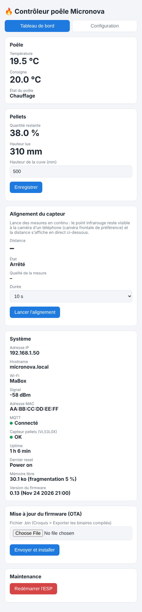
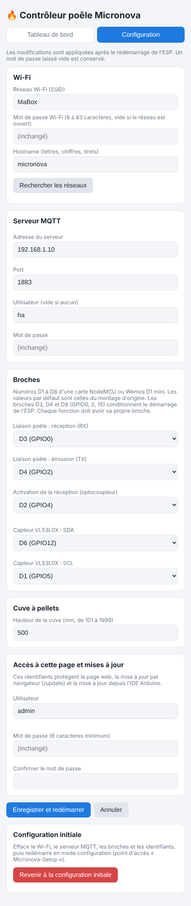
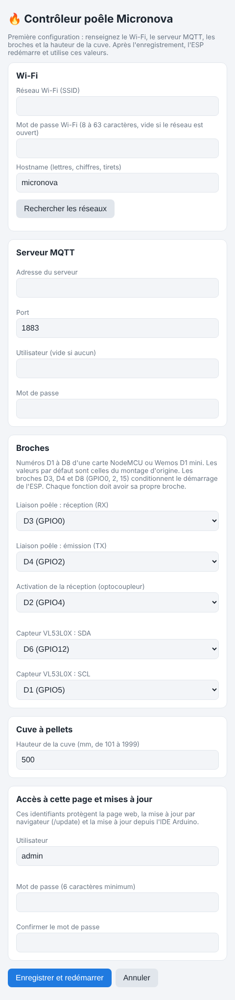
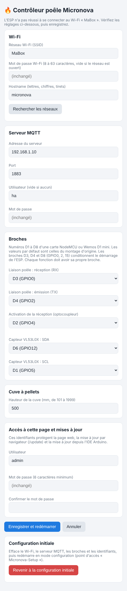

# Contrôleur Micronova (ESP8266) — Documentation technique

Document rédigé d'après le code du firmware **version 0.13** (`botero2_Nov25_hostname.ino`).

## Sommaire

1. [Description générale du projet](#1-description-générale-du-projet)
2. [Communication via le port série](#2-communication-via-le-port-série)
3. [Logique de lecture et d'écriture des valeurs](#3-logique-de-lecture-et-décriture-des-valeurs)
4. [Les fonctions et leurs usages](#4-les-fonctions-et-leurs-usages)
5. [Focus : l'autodiscovery MQTT](#5-focus--lautodiscovery-mqtt)
6. [Annexe : points d'attention connus](#6-annexe--points-dattention-connus)
7. [Historique des versions](#7-historique-des-versions)

---

## 1. Description générale du projet

### Objectif

Ce firmware transforme un ESP8266 en passerelle entre un **poêle à pellets équipé d'une carte Micronova** et **Home Assistant** (HA). Il permet de :

- lire l'état du poêle (arrêté, allumage, chauffage, alarme…), la température ambiante, la puissance et la consigne ;
- commander le poêle (marche, arrêt, stand-by, puissance, consigne de température) ;
- mesurer le niveau de pellets dans la cuve avec un capteur de distance VL53L0X ;
- aider à positionner ce capteur dans la cuve (mode alignement : infrarouge émis en continu, distance affichée en direct) ;
- signaler à HA qu'il est en vie et que le capteur de pellets fonctionne (heartbeat MQTT), pour détecter une panne, et lui communiquer son adresse IP ;
- déclarer automatiquement tous les capteurs et commandes dans HA (MQTT discovery) ;
- se configurer sans toucher au code : au premier démarrage, une page web (point d'accès Wi-Fi « Micronova-Setup ») permet de saisir le Wi-Fi, le serveur MQTT, les broches, la hauteur de cuve et les identifiants web, puis l'ESP redémarre avec ces valeurs ;
- se modifier ensuite depuis la même interface (onglet Configuration) et se mettre à jour sans câble (page web, OTA).

### Architecture

```
 ┌──────────────┐  série 1200 bauds   ┌─────────────┐   Wi-Fi / MQTT   ┌──────────────┐
 │ Carte        │◄───────────────────►│  ESP8266    │◄────────────────►│ Broker MQTT  │
 │ Micronova    │  (optocoupleur)     │  (ce code)  │                  │ + Home       │
 │ du poêle     │                     │             │   HTTP (80)      │ Assistant    │
 └──────────────┘                     │  VL53L0X ───┤◄────────────────►│ navigateur   │
                                      │  (I²C)      │   OTA            └──────────────┘
                                      └─────────────┘
```

### Matériel et brochage

Les broches sont **saisies sur la page de configuration** (voir 3.7) et conservées en EEPROM. Les valeurs par défaut, celles du montage d'origine, sont reprises dans le formulaire :

| Fonction                    | Broche par défaut | GPIO | Variable      |
|-----------------------------|-------------------|------|---------------|
| Liaison poêle, réception    | D3                | 0    | `pinRx`       |
| Liaison poêle, émission     | D4                | 2    | `pinTx`       |
| Activation de la réception  | D2                | 4    | `pinEnableRx` |
| I²C SDA (VL53L0X)           | D6                | 12   | `pinSda`      |
| I²C SCL (VL53L0X)           | D1                | 5    | `pinScl`      |

Les choix possibles sont D1 à D8 d'une carte NodeMCU ou Wemos D1 mini (GPIO 0, 2, 4, 5, 12, 13, 14, 15), avec cinq broches différentes. GPIO16 (D0) est exclu : sans interruption, il ne convient ni à la liaison série logicielle ni à l'I²C. Les broches D3, D4 et D8 (GPIO 0, 2, 15) conditionnent le démarrage de l'ESP.


### Bibliothèques

`ESP8266WiFi`, `DNSServer` (portail captif du mode configuration), `PubSubClient` (MQTT), `SoftwareSerial` (liaison poêle), `Wire` et `Adafruit_VL53L0X` (capteur), `ESP8266WebServer` et `ESP8266HTTPUpdateServer` (web et mise à jour par navigateur), `ArduinoOTA` (mise à jour depuis l'IDE), `EEPROM` (hostname, hauteur de cuve, configuration).

### Fichiers

| Fichier                         | Rôle                                                              |
|---------------------------------|-------------------------------------------------------------------|
| `botero2_Nov25_hostname.ino`    | Le firmware : **le seul fichier nécessaire pour compiler**        |
| `DOCUMENTATION.md`, `DOCUMENTATION.en.md` | Cette documentation, en français et en anglais          |

Depuis la version 0.12, il n'y a plus de `secrets.h` ni de `secrets.example.h` : le Wi-Fi, le MQTT, les broches et les identifiants se saisissent sur la page de configuration et sont conservés en EEPROM, pas dans le code.


### Cycle de fonctionnement

1. **Démarrage** (`setup`) : lecture du hostname, de la hauteur de cuve et de la configuration en EEPROM. Sans configuration, l'ESP ouvre le point d'accès « Micronova-Setup » et sa page de configuration, puis attend (voir 3.7). Sinon : initialisation des broches, connexion Wi-Fi (avec repli sur le point d'accès si elle échoue), démarrage du serveur web et de l'OTA, connexion MQTT, publication de l'autodiscovery, abonnement aux commandes, initialisation du capteur VL53L0X, premier heartbeat.
2. **Boucle** (`loop`), en continu : maintien de la connexion MQTT, traitement des messages entrants (commandes), service des requêtes web et OTA, mesures en continu si le mode alignement est actif (`alignTick`).
3. **Toutes les 60 secondes** : interrogation du poêle et du capteur (`getStates`), évaluation de la santé du capteur (`updateSensorHealth`), publication du heartbeat et de l'adresse IP (`publishHeartbeat`) et d'un message de vie (`pong`). Au bout de plus de 10 mesures de distance en échec, l'ESP redémarre.

---

## 2. Communication via le port série

### Paramètres

| Paramètre          | Valeur                                             |
|--------------------|----------------------------------------------------|
| Débit              | 1200 bauds                                         |
| Format             | 8 bits de données, pas de parité, **2 bits de stop** (`SWSERIAL_8N2`) |
| Implémentation     | `SoftwareSerial` (`StoveSerial`), tampon de 256 octets |
| Broches            | RX = D3, TX = D4 par défaut (configurables, voir 3.7) |

L'ESP8266 n'a qu'un seul port série matériel, réservé au débogage (`Serial`, 115200 bauds). La liaison avec le poêle utilise donc un port série logiciel sur deux broches configurables (D3 et D4 par défaut).

### La broche `ENABLE_RX` (D2 par défaut)

Le code indique que cette broche commande la LED d'un optocoupleur : à `HIGH`, la LED est éteinte et la réception est inhibée. Elle est à `HIGH` par défaut (au démarrage et après chaque lecture). Elle passe à `LOW` juste après l'envoi d'une requête de lecture, pour laisser passer la réponse du poêle, puis revient à `HIGH` dans `checkStoveReply()`.

### Le protocole

La liaison est de type **requête / réponse**, le poêle ne parle que lorsqu'on l'interroge.

**Lecture : 2 octets envoyés, 2 octets reçus**

```
ESP → poêle :  [code de lecture] [adresse]
poêle → ESP :  [somme de contrôle] [valeur]
```

- Le code de lecture vaut `0x00` pour la mémoire RAM (`_RAMR`) ou `0x20` pour l'EEPROM (`_EEPROMR`).
- La somme de contrôle de la réponse vaut `code + adresse + valeur` (sur 8 bits).

Exemple, lecture de la température ambiante (RAM `0x01`), réponse pour 19,5 °C (valeur 39 = `0x27`) :

```
ESP → poêle :  00 01
poêle → ESP :  28 27        (0x28 = 0x00 + 0x01 + 0x27)
```

**Écriture : 4 octets envoyés, pas de réponse lue**

```
ESP → poêle :  [code d'écriture] [adresse] [valeur] [somme de contrôle]
```

- Le code d'écriture vaut `0x80` pour la RAM (`_RAMW`) ou `0xA0` pour l'EEPROM (`_EEPROMW`).
- La somme de contrôle vaut `code + adresse + valeur`, tronquée à 8 bits (`(char)(…)` dans le code).

Exemple, régler la consigne à 19 °C. Le poêle stocke la valeur ×2, donc 38 = `0x26` à l'adresse EEPROM `0x6B` :

```
ESP → poêle :  A0 6B 26 31   (0xA0 + 0x6B + 0x26 = 0x131, tronqué à 0x31)
```

Le code ne lit aucun accusé de réception après une écriture. Il attend simplement 2 secondes (ou relit les états) pour constater le résultat.

### Cartographie mémoire utilisée

**RAM (lecture seule, côté ESP)**

| Adresse | Constante        | Contenu                          | Unité / conversion |
|---------|------------------|----------------------------------|--------------------|
| `0x01`  | `ambTempAddr`    | Température ambiante             | valeur ÷ 2 = °C    |
| `0x03`  | `stovePwrAddr`   | Puissance réelle                 | 1 = Eco, 2 à 6 = P1 à P5 |
| `0x09`  | `blowTempAddr`   | Température de soufflage         | brute              |
| `0x21`  | `stoveStateAddr` | État du poêle (en écriture : marche, arrêt, stand-by) | code 0 à 13 |
| `0x37`  | `extractorAddr`  | Vitesse de l'extracteur          | brute              |
| `0x59`  | `blowSpeedAddr`  | Vitesse de soufflage             | brute              |
| `0x5C`  | `fumeTempAddr`   | Température des fumées           | brute              |
| `0x63`  | `visPelletAddr`  | Vitesse de la vis à pellets      | brute              |
| `0x75`  | `fixVacuumAddr`  | Dépression fixe                  | brute              |
| `0x76`  | `readVacuumAddr` | Dépression lue                   | brute              |
| `0x77`  | `multVacuumAddr` | Multiplicateur de dépression     | brute              |
| `0x9A`  | `cardTempAddr`   | Température de la carte          | valeur ÷ 2 = °C    |

**EEPROM du poêle (lecture et écriture)**

| Adresse | Constante     | Contenu                 | Remarque |
|---------|---------------|-------------------------|----------|
| `0x6B`  | `tempSetAddr` | Consigne de température | valeur stockée = °C × 2 |
| `0xD0`  | `pwrSetAddr`  | Consigne de puissance   | 0 à 5    |

**Codes d'état du poêle (RAM `0x21`)**

| Code | État                  | Code | État                  |
|------|-----------------------|------|-----------------------|
| 0    | Arrêt                 | 7    | Chauffage             |
| 1    | Ventilation initiale  | 8    | Nettoyage creuset     |
| 2    | Préchauffage résistance | 9  | Nettoyage final       |
| 3    | Préchargement pellets | 10   | Attente stand-by      |
| 4    | Attente flamme        | 11   | Stand-by              |
| 5    | Attente allumage      | 12   | Alarme pellets        |
| 6    | Allumage              | 13   | Alarme (à investiguer)|

### Trames d'écriture prédéfinies

Les trames sont pré-calculées en constantes pour éviter tout recalcul :

| Constante                | Trame             | Effet                        |
|--------------------------|-------------------|------------------------------|
| `stoveOn`                | `80 21 01 A2`     | Mettre en marche             |
| `stoveStb`               | `80 21 0B AC`     | Mettre en stand-by           |
| `forceOff`               | `80 21 00 A1`     | Éteindre                     |
| `stovePWA`, `stovePW1`…`stovePW5` | `A0 D0 0n …` | Régler la puissance (n = 0 à 5) |

---

## 3. Logique de lecture et d'écriture des valeurs

### 3.1 Lecture

Chaque lecture suit la même séquence, dans les fonctions `getXxx()` :

```
1. StoveSerial.write(code de lecture)      // 0x00 (RAM) ou 0x20 (EEPROM)
2. delay(1)
3. StoveSerial.write(adresse)
4. digitalWrite(pinEnableRx, LOW)            // ouvre la réception
5. delay(80)                               // laisse le poêle répondre
6. checkStoveReply()                       // lit et interprète les 2 octets
```

**`checkStoveReply()`** :

1. Lit au plus 2 octets dans le tampon série (`stoveRxData[0]` = somme de contrôle, `[1]` = valeur).
2. Remet `pinEnableRx` à `HIGH`.
3. Si exactement 2 octets ont été reçus, **déduit l'adresse** de la réponse avec `param = somme de contrôle − valeur`. Comme la somme de contrôle vaut `code + adresse + valeur`, `param` vaut `code + adresse` : l'adresse pour une lecture RAM (code `0x00`), ou `0x20 + adresse` pour l'EEPROM.
4. Un `switch (param)` aiguille la valeur vers la bonne variable, applique la conversion (÷ 2 pour les températures) et la **publie sur MQTT** (retenue).

Grâce à cette déduction, la réponse n'a pas besoin d'être associée à la requête qui l'a provoquée : elle porte elle-même son adresse.

| Valeur reçue (`param`)      | Variable    | Topic MQTT publié                              |
|-----------------------------|-------------|------------------------------------------------|
| `0x01`                      | `ambTemp`   | `micronova/ambtemp` (°C)                       |
| `0x03`                      | `stovePower`| `micronova/stovepower` (Eco, P1…P5)            |
| `0x21`                      | `stoveState`| `micronova/stovestate` (texte) et `micronova/onoff` |
| `0x6B + 0x20` (EEPROM)      | `tempSet`   | `micronova/tempset` (°C), `micronova/settemp` (état du select) |
| `0xD0 + 0x20` (EEPROM)      | `pwrSet`    | `micronova/pwrset`                             |
| `0x09`, `0x5C`, `0x9A`, `0x37`, `0x59`, `0x63`, `0x75`, `0x76`, `0x77` | divers | `blowtemp`, `fumetemp`, `cardtemp`, `extractor`, `blowspeed`, `vispellet`, `fixvac`, `readvac`, `multvac` |

**Cycle périodique** : toutes les 60 s, `getStates()` appelle `getStovePower`, `getStoveState`, `getAmbTemp`, `getTempSet`, `getPowerSet` puis `getQte`. Les autres lectures (fumées, soufflage, vis, dépression…) existent dans le code mais ne sont pas appelées automatiquement.

### 3.2 Écriture (commandes)

Les commandes arrivent par MQTT sur le topic **`micronova/cmd`**. La fonction `callback()` lit le premier caractère du message pour choisir l'action :

| Payload     | Action                        | Détail                                                                 |
|-------------|-------------------------------|------------------------------------------------------------------------|
| `ON`        | Mettre en marche              | Envoie `stoveOn` si l'état est 0 (arrêt) ou supérieur à 10             |
| `ST`        | Stand-by                      | Envoie `stoveStb` si l'état est compris entre 1 et 9                   |
| `OF…`       | Éteindre                      | Envoie `forceOff` quel que soit l'état                                 |
| `P0`…`P5`   | Puissance                     | Choisit la trame `stovePWA`, `stovePW1`…`stovePW5`                     |
| `T<n>`      | Consigne de température       | `n` est lu avec `atof`, arrondi, puis écrit tel quel à l'EEPROM `0x6B` |

**Point clé de la consigne** : la valeur envoyée dans `T<n>` est la valeur **telle que le poêle la stocke**, donc la température × 2. Choisir 19 °C envoie `T38`, 18,5 °C envoie `T37`. C'est le `command_template` du select dans HA (`T{{ ((value | float) * 2) | int }}`) qui fait la multiplication. En lecture, le firmware fait l'opération inverse (÷ 2) avant de publier.

Après une écriture, le firmware attend 2 secondes (`ON`, `ST`, `OF`, `P`) ou 10 ms (`T`). Pour `ON`, `ST`, `OF` et `T`, il appelle ensuite `getStates()` pour republier l'état réel du poêle ; pour `P`, l'appel est commenté dans le code, et la nouvelle puissance n'est relue qu'au cycle suivant. Pour `ON`, `ST` et `OF`, il publie aussi tout de suite un état provisoire sur `micronova/onoff` (`Marche`, `Attente`, `Eteint`).

### 3.3 Mesure du niveau de la cuve

`getQte()` lit le VL53L0X, un capteur de distance placé au-dessus des pellets :

```
quantité (%) = (hauteur_cuve − distance) / hauteur_cuve × 100
```

- `hauteur_cuve` vaut 500 mm par défaut et se règle depuis la page web (de 101 à 1999 mm). Depuis la version 0.10, la valeur est conservée en EEPROM et relue au démarrage (voir 3.5).
- Une mesure n'est faite que **tous les 11 cycles** (environ 11 minutes), via le compteur `measure_sleep`.
- Une distance supérieure à 1000 mm est comptée comme une erreur (`count_reboot`) et met `lastMeasureOk` à faux. Plus de 10 mesures en erreur consécutives déclenchent un redémarrage de l'ESP ; une mesure valide remet le compteur à zéro et `lastMeasureOk` à vrai. Un statut « hors portée » du capteur (statut 4) est seulement journalisé, sans être compté.
- Si le capteur n'est pas initialisé (absent au démarrage ou disparu du bus I²C), `getQte()` ne tente aucune mesure : elle met `lastMeasureOk` à faux, journalise l'information et s'arrête (voir 3.4).
- La distance est publiée à chaque mesure sur `micronova/distance`. La quantité n'est publiée sur `micronova/qte` que si elle varie d'au moins 10 points depuis la dernière valeur publiée.

### 3.4 Heartbeat et santé du capteur

Depuis la version 0.7, le firmware signale à HA qu'il est en vie et que le capteur de pellets fonctionne. La quantité n'étant publiée que si elle varie d'au moins 10 points, son silence ne permet pas de détecter une panne : ces deux messages comblent ce manque.

| Topic                    | Contenu                                                           | Rythme          |
|--------------------------|-------------------------------------------------------------------|-----------------|
| `micronova/heartbeat`    | Durée de fonctionnement de l'ESP, en secondes (`millis() / 1000`) | toutes les 60 s |
| `micronova/sensorstatus` | `ON` si le capteur est sain, `OFF` sinon                          | toutes les 60 s |
| `micronova/ip`           | Adresse IP de l'ESP (par exemple `192.168.1.50`)                  | toutes les 60 s |

Le heartbeat et l'état du capteur sont publiés **sans l'option retenue** : un message retenu serait renvoyé à HA après son redémarrage et ferait croire que l'ESP est en vie. Un premier envoi a lieu à la fin de `setup()`, sans attendre 60 s.

L'**adresse IP** (ajoutée en version 0.8) fait exception : elle est publiée **avec l'option retenue**. On veut ainsi retrouver dans HA la dernière IP connue de l'ESP même quand il est éteint ou injoignable, ce qui sert justement à le dépanner. Elle est republiée à chaque cycle de 60 s, donc un changement d'adresse (nouveau bail DHCP) est pris en compte en moins d'une minute. Elle n'a pas d'`expire_after` : l'entité ne passe jamais en « indisponible » à cause de ce topic.

L'état du capteur est calculé par `updateSensorHealth()` à chaque cycle de 60 s, juste après `getStates()` :

```
sensorOk = capteur présent sur le bus I²C  ET  capteur initialisé  ET  dernière mesure valide
```

- **Présence** : `sensorPresentI2C()` interroge l'adresse `0x29` (adresse par défaut du VL53L0X). Un fil débranché est donc détecté en moins d'une minute, sans faire de mesure.
- **Initialisation** : le résultat de `lox.begin()` est mémorisé dans `sensorInitialized`. Si le capteur disparaît du bus puis revient, `updateSensorHealth()` le réinitialise automatiquement (auparavant, un échec à l'initialisation n'était jamais retenté sans redémarrage).
- **Dernière mesure** (`lastMeasureOk`) : passe à faux sur une distance supérieure à 1000 mm, revient à vrai sur une mesure valide. Une mesure n'ayant lieu que tous les 11 cycles, une mesure aberrante peut mettre jusqu'à 11 minutes à apparaître. Le statut « hors portée » (statut 4) ne modifie pas cet état.

Côté HA, deux entités reprennent ces topics (voir section 5). Elles ont un `expire_after` de 180 s : sans message pendant 3 minutes, elles passent en « indisponible ».

| État de l'entité « Capteur pellets » | Signification                                                  |
|--------------------------------------|----------------------------------------------------------------|
| `on`                                 | Tout va bien                                                   |
| `off`                                | L'ESP répond, mais le capteur est en défaut                    |
| `unavailable`                        | Plus de message depuis 3 minutes : ESP, Wi-Fi ou MQTT en panne |

Exemple d'automatisation HA (les identifiants d'entités sont à vérifier dans votre installation ; le délai de 3 minutes évite les fausses alertes au redémarrage de HA, quand les entités sont brièvement indisponibles) :

```yaml
alias: Micronova - capteur de pellets en défaut
triggers:
  - trigger: state
    entity_id: binary_sensor.micronova_controller_capteur_pellets
    to:
      - "off"
      - unavailable
    for: "00:03:00"
actions:
  - action: notify.notify
    data:
      title: "Poêle à pellets"
      message: >
        {{ 'Le contrôleur Micronova ne répond plus (ESP, Wi-Fi ou MQTT).'
           if is_state('sensor.micronova_controller_heartbeat', 'unavailable')
           else 'Le capteur de niveau de pellets est déconnecté ou renvoie des valeurs aberrantes.' }}
mode: single
```

### 3.5 Stockage local (EEPROM de l'ESP)

L'EEPROM (432 octets réservés) conserve le hostname, la hauteur de la cuve et, depuis la version 0.12, toute la configuration saisie sur la page web :

| Octets  | Contenu                                                              |
|---------|----------------------------------------------------------------------|
| 0       | Marqueur `0xA5` (un hostname est stocké)                             |
| 1       | Longueur du hostname (1 à 32)                                        |
| 2 à 33  | Caractères du hostname                                               |
| 40      | Marqueur `0xB7` (une hauteur de cuve est stockée)                    |
| 41      | Hauteur de la cuve en mm, octet de poids faible                      |
| 42      | Hauteur de la cuve en mm, octet de poids fort                        |
| 64 à 431 | Configuration (structure `StoredCfg`, marqueur `0xC0F10012`) : Wi-Fi (réseau, mot de passe), serveur MQTT (adresse, port, utilisateur, mot de passe), les cinq broches (numéros de GPIO), utilisateur et mot de passe web |

Sans marqueur valide, ou si le contenu n'est pas un hostname correct, c'est la valeur par défaut `micronova` qui est utilisée. De même, sans marqueur `0xB7` valide, ou si la hauteur n'est pas comprise entre 101 et 1999 mm, la valeur par défaut de 500 mm est conservée. La hauteur n'est écrite que si elle a changé, pour ménager la flash.

Sans marqueur `0xC0F10012`, ou si le Wi-Fi, l'adresse MQTT, l'utilisateur web ou son mot de passe manquent, l'ESP considère qu'il n'est pas configuré et ouvre le portail de configuration. Une broche invalide ou en double dans la structure est ignorée : les broches d'origine restent utilisées.

Les mots de passe sont stockés **en clair** dans la flash de l'ESP.


### 3.6 Mode alignement du capteur

Depuis la version 0.9, la page web propose un mode alignement pour positionner le VL53L0X dans la cuve. Le capteur n'émet son infrarouge (940 nm) que pendant une mesure : en temps normal, cela représente quelques millisecondes toutes les 11 minutes, donc rien de visible. En mode alignement, l'ESP mesure en continu (environ 20 fois par seconde) pendant la durée choisie. Le point infrarouge devient visible à la caméra d'un téléphone (la caméra frontale, dont le filtre infrarouge est souvent plus faible, convient mieux), et la distance s'affiche en direct sur la page.

- **Démarrage** : `POST /align/start` avec la durée en secondes. La page propose 10, 30, 60 ou 120 s ; les valeurs acceptées vont de 5 à 120 s, avec 10 s par défaut. La demande est refusée (HTTP 503) si le capteur n'est pas initialisé.
- **Fonctionnement** : non bloquant. `alignTick()` est appelée à chaque passage de `loop()` et fait une mesure (`lox.rangingTest`) tant que le mode est actif. MQTT, la page web et l'OTA continuent de répondre.
- **Fin** : automatique à l'échéance (journal `Align : mode alignement termine.`).
- **Suivi** : la page lit `alignActive`, `alignRemain`, `alignDistance` et `alignStatus` dans `/api/status`, toutes les 0,5 s pendant l'alignement. `alignStatus` est le code d'état du VL53L0X : 0 = mesure valide, 4 = pas de retour (cible hors portée, trop sombre ou mal orientée), autre valeur = mesure douteuse, -1 = aucune mesure.
- **Portée des mesures** : elles ne sont pas publiées sur MQTT et ne modifient ni `distance`, ni la quantité, ni `lastMeasureOk`.
- **Conseil** : le faisceau forme un cône d'environ 25°. Il faut le dégager des parois et du couvercle de la cuve ; une distance qui saute ou un statut « Pas de retour » indiquent un mauvais alignement.

### 3.7 Première configuration et configuration ultérieure

Depuis la version 0.12, aucun réglage n'est écrit dans le code : le Wi-Fi, le serveur MQTT, les broches, la hauteur de cuve et les identifiants web sont saisis sur la page de configuration et conservés en EEPROM (voir 3.5).

**Premier démarrage (aucune configuration enregistrée)**

1. `setup()` constate l'absence de configuration (`cfgConfigured` faux) et appelle `startPortal(true)`.
2. L'ESP cherche les réseaux Wi-Fi à portée (liste mise en cache), puis ouvre le point d'accès **`Micronova-Setup`**, ouvert par défaut (constantes `AP_SSID` et `AP_PASS`). Un serveur DNS renvoie toute adresse vers l'ESP (portail captif) : sur un téléphone, la page s'ouvre d'elle-même, sinon à l'adresse `http://192.168.4.1`.
3. Le serveur web ne sert que la page, limitée à l'onglet Configuration, et les routes de configuration, **sans mot de passe** puisqu'aucun n'existe encore. Le poêle, le capteur, le MQTT et l'OTA ne sont pas démarrés, et les broches ne sont pas touchées.
4. Le formulaire est pré-rempli : broches d'origine, port MQTT 1883, hauteur de cuve 500 mm (ou la valeur déjà stockée), hostname déjà stocké ou `micronova`, utilisateur web `admin`.
5. `POST /api/config` valide les valeurs, les enregistre, puis redémarre l'ESP au bout d'une demi-seconde. Au démarrage suivant, `loadConfig()` relit ces valeurs et l'ESP fonctionne normalement.

**Règles de validation**

| Champ                           | Règle |
|---------------------------------|-------|
| Réseau Wi-Fi                    | 1 à 32 caractères |
| Mot de passe Wi-Fi              | 8 à 63 caractères, ou vide pour un réseau ouvert |
| Hostname                        | 1 à 32 caractères : lettres, chiffres, tirets, sans tiret au début ni à la fin |
| Serveur MQTT                    | 1 à 64 caractères, sans espace ni « / » |
| Port MQTT                       | 1 à 65535 |
| Utilisateur, mot de passe MQTT  | 32 et 63 caractères au plus. Utilisateur vide : connexion sans authentification |
| Broches                         | D1 à D8 (GPIO 0, 2, 4, 5, 12, 13, 14, 15), cinq broches différentes |
| Hauteur de cuve                 | 101 à 1999 mm |
| Utilisateur web                 | 1 à 32 caractères, sans « : » |
| Mot de passe web                | 6 à 63 caractères |

Quand la configuration est déjà enregistrée, un mot de passe laissé vide est **conservé** : le mot de passe web toujours, celui du Wi-Fi tant que le réseau ne change pas, celui du MQTT tant que l'utilisateur ne change pas. Les mots de passe ne sont jamais renvoyés à la page (le formulaire affiche « (inchangé) »).

**Wi-Fi injoignable (configuration présente)**

- Si la connexion au Wi-Fi n'aboutit pas en 30 secondes (`WIFI_CONNECT_TIMEOUT_MS`), l'ESP ouvre le même point d'accès avec `startPortal(false)`. Cette fois, la page demande l'utilisateur et le mot de passe web, et affiche un message sur l'échec de la connexion.
- Sans activité sur la page pendant 5 minutes (`PORTAL_RETRY_MS`), l'ESP redémarre pour retenter la connexion. Cela couvre une box encore en démarrage après une coupure de courant. Pendant que la page est ouverte, elle interroge l'ESP chaque minute pour éviter ce redémarrage en pleine saisie.
- Le point d'accès n'est ouvert qu'au démarrage : une perte du Wi-Fi en cours de fonctionnement relève de la reconnexion automatique de l'ESP.

**Serveur MQTT injoignable**

`reconnect_mqtt()` réessaie toutes les 5 secondes. Pendant l'attente, la page web et l'OTA restent servis : on peut donc corriger l'adresse, le port ou les identifiants MQTT depuis l'onglet Configuration.

**Modifier la configuration ensuite**

Quand l'ESP est connecté, l'onglet **Configuration** de la page principale propose le même formulaire (pré-rempli avec les valeurs en cours). « Enregistrer et redémarrer » applique les changements. « Annuler » recharge les valeurs en cours.

**Revenir à la configuration initiale**

Le bouton « Revenir à la configuration initiale » (route `POST /config/reset`, protégée par le mot de passe web) efface la configuration (`clearConfig()`) et redémarre : l'ESP rouvre le point d'accès « Micronova-Setup ». Le hostname et la hauteur de cuve sont conservés et pré-remplissent le formulaire. Si le mot de passe web est perdu, il faut reflasher l'ESP en effaçant toute la mémoire (option « Erase Flash : All Flash Contents » de l'IDE Arduino).

---

## 4. Les fonctions et leurs usages

### Démarrage et boucle

| Fonction       | Usage |
|----------------|-------|
| `setup()`      | Charge le hostname, la hauteur de cuve et la configuration. Sans configuration : ouvre le portail (`startPortal(true)`) et s'arrête là. Sinon : initialise les broches et le port série du poêle, se connecte au Wi-Fi (`connectWifi()`, repli sur `startPortal(false)`), démarre le serveur web (`setupWebServer()`) et l'OTA, se connecte à MQTT, initialise le capteur VL53L0X et publie un premier heartbeat. |
| `loop()`       | En mode configuration : DNS (`dnsServer.processNextRequest()`) et page web seulement, plus le redémarrage après 5 minutes d'inactivité si la configuration est présente. Sinon : rétablit la connexion MQTT si besoin, traite MQTT (`client.loop()`), les requêtes web (`webServer.handleClient()`) et l'OTA (`ArduinoOTA.handle()`), puis `alignTick()`. Toutes les 60 s : `getStates()`, `updateSensorHealth()`, `publishHeartbeat()`, message de vie (`pong`), vérification du compteur d'échecs. |


### Réseau et MQTT

| Fonction            | Usage |
|---------------------|-------|
| `connectWifi()`     | Applique le hostname, se connecte au Wi-Fi saisi dans la configuration (30 s au plus), affiche l'IP. Renvoie faux si la connexion échoue. |
| `startPortal()`     | Ouvre le point d'accès « Micronova-Setup », le serveur DNS et la page de configuration (voir 3.7). |
| `reconnect_mqtt()`  | Configure le serveur (adresse et port saisis) et la fonction de rappel, se connecte au broker (avec ou sans identifiants, nouvelle tentative toutes les 5 s, page web et OTA servis pendant l'attente), agrandit le tampon à 1024 octets, **publie l'autodiscovery**, puis s'abonne aux topics `cmd` et `hauteur`. |
| `callback()`        | Reçoit les messages MQTT et exécute les commandes (voir 3.2). |
| `mqttPublish()`     | Publie un message avec trace sur le port série et indication de réussite. |
| `Write_Log()`       | Publie un message sur `micronova/log` (non retenu) et l'affiche sur le port série. |


### Dialogue avec le poêle

| Fonction                | Usage |
|-------------------------|-------|
| `checkStoveReply()`     | Lit et interprète une réponse du poêle, puis publie la valeur (voir 3.1). |
| `getStoveState()`       | Lit l'état du poêle (RAM `0x21`). |
| `getAmbTemp()`          | Lit la température ambiante (RAM `0x01`). |
| `getStovePower()`       | Lit la puissance réelle (RAM `0x03`). |
| `getTempSet()`          | Lit la consigne de température (EEPROM `0x6B`). |
| `getPowerSet()`         | Lit la consigne de puissance (EEPROM `0xD0`). |
| `getFumeTemp()`, `getBlowTemp()`, `getCardTemp()`, `getExtractor()`, `getBlowSpeed()`, `getVisPellet()`, `getFixVacuum()`, `getReadVacuum()`, `getMultVacuum()` | Lectures complémentaires (non appelées par défaut). |
| `getQte()`              | Mesure la distance avec le VL53L0X et calcule le niveau de la cuve (voir 3.3). Ne fait rien si le capteur n'est pas initialisé. |
| `getStates()`           | Regroupe les lectures du cycle périodique. |

### Santé du capteur et heartbeat

| Fonction                | Usage |
|-------------------------|-------|
| `sensorPresentI2C()`    | Interroge l'adresse I²C `0x29` : renvoie vrai si le VL53L0X répond (détecte un fil débranché sans faire de mesure). |
| `updateSensorHealth()`  | Appelée toutes les 60 s : teste la présence du capteur, le réinitialise (`lox.begin()`) s'il est revenu, puis calcule `sensorOk` (voir 3.4). |
| `publishHeartbeat()`    | Publie l'uptime sur `micronova/heartbeat` et `ON` / `OFF` sur `micronova/sensorstatus`, sans l'option retenue, puis l'adresse IP sur `micronova/ip`, avec l'option retenue. |

### Page web

La page est stockée une fois pour toutes en mémoire programme (`INDEX_HTML`, environ 20 Ko) et **interroge l'ESP** en arrière-plan pour afficher l'état. Les actions passent par des appels sans rechargement de la page : chacune renvoie un court message texte, affiché sous le formulaire. Le thème clair ou sombre suit celui de l'appareil. L'interface s'inspire de celle du projet `watermeter2mqtt`.

Elle comporte deux onglets :

- **Tableau de bord** : l'état du poêle et du capteur, le mode alignement, les informations système, la mise à jour du firmware et le redémarrage. Elle se rafraîchit toute seule toutes les 5 s (toutes les 0,5 s pendant un alignement) avec `GET /api/status`.
- **Configuration** : le formulaire de la section 3.7. Il est chargé avec `GET /api/config` et enregistré avec `POST /api/config`.

L'adresse `/config` sert la même page, ouverte sur l'onglet Configuration. En mode configuration (premier démarrage ou Wi-Fi injoignable), la page n'affiche que cet onglet.

**Accès protégé** : les routes demandent un identifiant et un mot de passe (authentification HTTP basique, `checkAuth()`), à savoir l'utilisateur et le mot de passe web saisis dans la configuration. La route `/update` et l'OTA de l'IDE Arduino utilisent la même paire. Pendant la première configuration, aucun identifiant n'existe : seule la page de configuration est servie, sans mot de passe.

| Fonction             | Usage |
|----------------------|-------|
| `INDEX_HTML`         | Page complète (HTML, CSS, JavaScript) conservée en mémoire programme. |
| `jsonEscape()`       | Échappe une chaîne pour l'insérer dans le JSON. |
| `checkAuth()`        | Authentification HTTP basique avec les identifiants web de la configuration (aucun contrôle pendant la première configuration). |
| `handleRoot()`       | Route `GET /` : envoie la page. |
| `handleConfigPage()` | Route `GET /config` : envoie la même page, ouverte sur l'onglet Configuration. |
| `handleStatus()`     | Route `GET /api/status` : renvoie tout l'état en JSON (hors mode configuration). |
| `handleSet()`        | Route `POST /set` : enregistre la hauteur de la cuve (valeur strictement comprise entre 100 et 2000), en mémoire et en EEPROM, sans redémarrage. |
| `handleConfigGet()`  | Route `GET /api/config` : valeurs en cours de la configuration (sans les mots de passe). |
| `handleConfigSave()` | Route `POST /api/config` : valide, enregistre en EEPROM, puis redémarre (voir 3.7). |
| `handleConfigReset()`| Route `POST /config/reset` : efface la configuration et redémarre en mode configuration. |
| `handleScan()`       | Route `GET /api/scan` : liste des réseaux Wi-Fi mise en cache (`?refresh=1` relance une recherche, via `scanNetworksJson()`). |
| `handleReboot()`     | Route `POST /reboot` : redémarre l'ESP (hors mode configuration). |
| `handleAlignStart()` | Route `POST /align/start` : démarre le mode alignement (voir 3.6, hors mode configuration). |
| `handleNotFound()`   | En mode configuration, renvoie vers la page (portail captif, via `redirectToConfig()`). Sinon, erreur 404. |
| `setupWebServer()`   | Déclare les routes. En mode configuration, seules `/`, `/config`, `/api/config`, `/api/scan` et `/config/reset` sont actives, sans `/update`. |
| `httpUpdater`        | Route `/update` : réception d'un firmware (`.bin`) depuis la page ou le navigateur, protégée par identifiant et mot de passe. |

L'API `/api/status` renvoie : `temperature`, `consigne`, `state`, `distance`, `qte`, `hauteur`, `alignActive`, `alignRemain`, `alignDistance`, `alignStatus`, `ip`, `hostname`, `ssid`, `rssi`, `mac`, `mqtt`, `sensorOk`, `uptime`, `resetReason`, `heap`, `frag`, `version` et `build`.

L'API `/api/config` renvoie : `first` (aucune configuration enregistrée), `portal` (mode configuration), `wifiFailed`, `ssid`, `hostname`, `hasWifiPass`, `mqttHost`, `mqttPort`, `mqttUser`, `hasMqttPass`, `pinRx`, `pinTx`, `pinEn`, `pinSda`, `pinScl`, `hauteur` et `webUser`.

L'onglet **Tableau de bord** est organisé en cartes :

| Carte                          | Contenu |
|--------------------------------|---------|
| Poêle                          | Température, consigne, état du poêle |
| Pellets                        | Quantité restante, hauteur lue, formulaire de la hauteur de cuve |
| Alignement du capteur          | Distance en direct, temps restant, qualité de la mesure, choix de la durée (10, 30, 60 ou 120 s), bouton de lancement |
| Système                        | Adresse IP, hostname (`.local`), Wi-Fi et signal, adresse MAC, MQTT et capteur pellets (pastille verte ou rouge), uptime, cause du dernier reset, mémoire libre et fragmentation, version et date de compilation |
| Mise à jour du firmware (OTA)  | Choix du fichier `.bin` et envoi |
| Maintenance                    | Redémarrage de l'ESP |

L'onglet **Configuration** reprend les cartes Wi-Fi (réseau, mot de passe, hostname, recherche des réseaux), Serveur MQTT, Broches, Cuve à pellets, Accès à cette page et mises à jour (utilisateur, mot de passe et confirmation), puis une carte « Configuration initiale » pour tout effacer.

**Mise à jour par la page** : la page envoie le fichier `.bin` (Croquis > Exporter les binaires compilés) en `POST /update` (champ `update`), avec l'avancement en pourcentage. Une fois installé, l'ESP redémarre et la page se recharge au bout de 20 s. La mise à jour depuis l'IDE Arduino (`ArduinoOTA`, protégée par le mot de passe web) fonctionne toujours, et la page `GET /update` intégrée à la bibliothèque reste accessible.

**Captures d'écran**

| Tableau de bord | Configuration |
|---|---|
|  |  |

| Premier démarrage (point d'accès) | Repli si le Wi-Fi échoue |
|---|---|
|  |  |


### Hostname

| Fonction              | Usage |
|-----------------------|-------|
| `isValidHostname()`   | Vérifie 1 à 32 caractères : lettres, chiffres et tirets, sans tiret au début ni à la fin. |
| `loadHostname()`      | Lit le hostname en EEPROM, ou prend la valeur par défaut. |
| `saveHostname()`      | Écrit le hostname en EEPROM. |

### Configuration

| Fonction              | Usage |
|-----------------------|-------|
| `isValidPin()`        | Vérifie qu'un numéro de GPIO fait partie des broches utilisables (D1 à D8). |
| `pinsAreDistinct()`   | Vérifie que les cinq fonctions utilisent cinq broches différentes. |
| `loadConfig()`        | Lit la configuration en EEPROM et renseigne les variables `cfg*` et les broches. `cfgConfigured` reste faux si elle est absente ou incomplète. |
| `saveConfig()`        | Écrit la configuration en EEPROM. |
| `clearConfig()`       | Efface la configuration (retour à la configuration initiale). |

### Hauteur de cuve et alignement

| Fonction            | Usage |
|---------------------|-------|
| `loadHauteur()`     | Lit la hauteur de la cuve en EEPROM (octets 40 à 42), ou garde la valeur par défaut de 500 mm si elle est absente ou hors plage. |
| `saveHauteur()`     | Écrit la hauteur en EEPROM, seulement si elle a changé. |
| `alignTick()`       | Appelée à chaque passage de `loop()` : fait une mesure tant que le mode alignement est actif, et l'arrête à l'échéance (voir 3.6). |

---

## 5. Focus : l'autodiscovery MQTT

### Principe

Plutôt que de déclarer chaque entité à la main dans HA, le firmware **publie lui-même la description** de ses capteurs et commandes sur des topics spéciaux. HA les surveille (préfixe `homeassistant/`) et crée automatiquement les entités correspondantes, regroupées dans un seul appareil.

### Structure d'un topic de découverte

```
homeassistant/<composant>/<node_id>/<object_id>/config
```

Exemples du code :

```
homeassistant/switch/Micronova/Controller/config
homeassistant/sensor/Micronova/Temperature/config
homeassistant/select/micronova/Controller/config
```

Le message est un **JSON**, publié avec l'option **retenue** (`retain = true`) : le broker le garde et le renvoie à HA à chacun de ses démarrages, même si l'ESP est éteint.

### Quand et comment c'est publié

La publication se fait dans `reconnect_mqtt()`, **à chaque connexion au broker** :

1. Connexion au broker (identifiant client `ESPClient`, avec l'utilisateur et le mot de passe saisis dans la configuration, ou sans authentification si l'utilisateur est vide).
2. **`client.setBufferSize(1024)`** : indispensable, car la taille par défaut de PubSubClient (256 octets) est inférieure à celle des messages de découverte, qui seraient sinon perdus sans erreur visible.
3. Pour chaque entité : `client.publish(topic, json, true)`, puis `client.loop()` et `delay(150)` pour ne pas saturer le broker ni l'ESP.
4. Abonnement au topic de commande.

Republier à chaque connexion est sans danger : les messages sont identiques aux précédents et HA ne recrée rien.

### Le bloc « appareil »

Toutes les entités embarquent la même description d'appareil (macro `device_information`), ce qui les regroupe dans HA :

```json
{
  "manufacturer": "Philibert Cheminot",
  "identifiers": ["42396f39-80d2-493b-8e8e-31a70e700bc6"],
  "model": "Micronova Controller",
  "name": "Micronova Controller",
  "sw_version": "0.13"
}
```

`identifiers` est la clé qui rassemble les entités sous un seul appareil. `sw_version` reprend la constante `FW_VERSION`.

### Les entités déclarées

| Composant | Nom           | Topic d'état            | Topic de commande | Remarques |
|-----------|---------------|-------------------------|-------------------|-----------|
| `select`  | Temperature   | `micronova/settemp`     | `micronova/cmd`   | Options 17 à 21 par pas de 0,5. `command_template` : `T{{ ((value \| float) * 2) \| int }}` |
| `switch`  | Controller    | `micronova/onoff`       | `micronova/cmd`   | `payload_on` = `ON`, `payload_off` = `OFF` |
| `sensor`  | Controller    | `micronova/pong`        | —                 | Message de vie (« Connecté ») |
| `sensor`  | Temperature   | `micronova/ambtemp`     | —                 | °C, `device_class: temperature` |
| `sensor`  | Consigne      | `micronova/tempset`     | —                 | °C, `device_class: temperature` |
| `sensor`  | State         | `micronova/stovestate`  | —                 | Texte de l'état du poêle |
| `sensor`  | Distance      | `micronova/distance`    | —                 | mm, `device_class: distance` |
| `sensor`  | Quantite      | `micronova/qte`         | —                 | % |
| `sensor`  | log           | `micronova/log`         | —                 | Messages de journal |
| `sensor`  | hauteur       | `micronova/hauteur`     | —                 | Hauteur de la cuve |
| `sensor`  | Heartbeat     | `micronova/heartbeat`   | —                 | Uptime en secondes, `device_class: duration`, catégorie diagnostic, `expire_after` 180 s |
| `binary_sensor` | Capteur pellets | `micronova/sensorstatus` | —          | `payload_on` = `ON`, `payload_off` = `OFF`, `device_class: connectivity`, `expire_after` 180 s |
| `sensor`  | Adresse IP    | `micronova/ip`          | —                 | Catégorie diagnostic, message retenu, pas d'`expire_after` |

### Anatomie d'un message (exemple : capteur de température)

```json
{
  "name": "Temperature",
  "state_topic": "micronova/ambtemp",
  "qos": 0,
  "device_class": "temperature",
  "state_class": "measurement",
  "unit_of_measurement": "°C",
  "icon": "mdi:thermometer",
  "unique_id": "9db3245e-6ace-4d14-ac07-844cd68d245d",
  "device": { "...": "voir le bloc appareil" }
}
```

- `state_topic` : le topic sur lequel HA lit la valeur.
- `device_class` et `state_class` : permettent à HA de gérer l'unité, l'affichage et les statistiques longue durée.
- **`unique_id`** : identifiant stable de l'entité. HA s'en sert pour retrouver son `entity_id`, son historique et ses automatisations. **Il ne doit jamais changer.**

### Cas particulier : le select de consigne

Le select travaille en °C, alors que le poêle stocke la consigne ×2 :

- **Commande** : le `command_template` multiplie la valeur par 2 avant l'envoi (`19` devient `T38`).
- **État** : le firmware relit la consigne dans l'EEPROM du poêle, puis publie sur `micronova/settemp` un texte qui correspond **exactement** à une option (`19` ou `19.5`). Sans cette correspondance, le select afficherait « inconnu ».

Le code contient aussi, en commentaire, une variante avec une entité `number` (curseur de 15 à 25 par pas de 0,5). Un `number` est une alternative possible au select si l'on veut piloter la consigne depuis une carte thermostat.

### Cas particulier : heartbeat et `expire_after`

Les entités **Heartbeat** et **Capteur pellets** déclarent `"expire_after": 180` : si HA ne reçoit aucun message sur leur topic pendant 180 secondes, il les passe en « indisponible ». L'ESP publiant toutes les 60 s, il faut manquer trois messages d'affilée pour en arriver là. Leurs messages d'état ne sont pas retenus (voir 3.4) : sinon, HA recevrait un ancien message à son démarrage et croirait l'ESP en vie. Leurs topics de découverte :

```
homeassistant/sensor/Micronova/Heartbeat/config
homeassistant/binary_sensor/Micronova/PelletSensor/config
```

L'entité **Adresse IP** (`homeassistant/sensor/Micronova/IP/config`) se comporte différemment : son message d'état est retenu et elle n'a pas d'`expire_after`, de façon à conserver la dernière adresse connue (voir 3.4).

### Modifier ou supprimer une entité

| Situation | Que faire |
|-----------|-----------|
| Changer une option, un nom, une icône | Modifier le JSON : au prochain démarrage, HA met l'entité à jour (recharger l'intégration MQTT si besoin). |
| Changer le `unique_id` ou le topic de découverte | HA verra **une nouvelle entité** et gardera l'ancienne en « indisponible » : à éviter. |
| Supprimer une entité | Publier un **message vide, retenu**, sur son topic `…/config` (par exemple avec MQTT Explorer), puis retirer l'appel `publish` du code. |

---

## 6. Annexe : points d'attention connus

Ces points ressortent de la lecture du code. Ils ne sont pas corrigés dans la version 0.13.

1. **Commande MQTT `H` inopérante.** Depuis la version 0.10, la hauteur de cuve est conservée en EEPROM et se règle depuis la page web. En revanche, la commande MQTT `H` (abonnement au topic `micronova/hauteur`) lit toujours la valeur sans l'affecter, et n'accepte que les messages de 3 caractères : la hauteur ne peut pas être modifiée par MQTT.
2. **Plantage possible sur `P`.** Un message `P` suivi d'un caractère autre que 0 à 5 laisse un pointeur nul (`stovePW`) qui est ensuite utilisé pour l'écriture.
3. **Nom du capteur « hauteur ».** Il est déclaré avec le nom `log`, comme le capteur de journal : sans doute un copier-coller.
4. **États du switch.** Le switch attend `ON` / `OFF` sur `micronova/onoff` (`state_on` / `state_off`), alors que le firmware publie `Marche`, `Eteint`, `Arrêt` ou `Attente`. À vérifier : HA peut ignorer ces messages et ne pas refléter l'état réel.
5. **Attentes bloquantes.** Chaque lecture bloque 80 ms, chaque commande 2 secondes, la mesure du capteur 200 ms de plus. La connexion au Wi-Fi attend jusqu'à 30 secondes au démarrage. Pendant les tentatives de connexion MQTT (toutes les 5 secondes), la page web et l'OTA restent servis, mais la tentative elle-même peut bloquer plusieurs secondes si le serveur est injoignable. Pendant ces pauses, la page peut répondre lentement.
6. **Lectures inutilisées.** Les fonctions de lecture des fumées, du soufflage, de la vis et des dépressions ne sont pas appelées dans le cycle périodique.
7. **Pas de redémarrage automatique si le capteur disparaît du bus I²C.** Dans ce cas, `getQte()` s'arrête avant la mesure et ne compte donc aucune erreur dans `count_reboot` : le redémarrage après plus de 10 échecs ne se déclenche plus. Il reste actif pour les distances aberrantes. La panne est signalée à HA par `micronova/sensorstatus`.
8. **Détection lente des mesures aberrantes.** Une mesure n'ayant lieu que tous les 11 cycles, un capteur qui renvoie des valeurs aberrantes peut mettre jusqu'à 11 minutes à passer en défaut. Un capteur débranché est détecté en moins d'une minute.
9. **Uptime limité à environ 49 jours.** L'uptime du heartbeat et de la page web vient de `millis()`, qui repasse à zéro après environ 49,7 jours.
10. **Alignement et cycle de 60 s.** Pendant un alignement, le cycle périodique s'exécute normalement (interrogation du poêle, environ une demi-seconde bloquante) : le suivi en direct marque alors une brève pause.
11. **Identifiants partagés, sans chiffrement.** La page web, la mise à jour par navigateur et l'OTA de l'IDE utilisent les mêmes identifiants web, saisis dans la configuration. L'authentification HTTP basique circule en clair sur le réseau local (pas de HTTPS), et les mots de passe (Wi-Fi, MQTT, web) sont stockés en clair dans la flash de l'ESP.
12. **Point d'accès ouvert pendant la première configuration.** Tant que l'ESP n'est pas configuré, toute personne à portée peut se connecter à « Micronova-Setup » et saisir une configuration. On peut le protéger en renseignant `AP_PASS` (8 caractères minimum) dans le code.
13. **Mot de passe web perdu.** Il n'existe pas de bouton physique de remise à zéro : il faut reflasher l'ESP en effaçant toute la mémoire (option « Erase Flash : All Flash Contents »).
14. **Wi-Fi perdu en cours de fonctionnement.** Le point d'accès de configuration n'est ouvert qu'au démarrage. Après une coupure du Wi-Fi, l'ESP compte sur sa reconnexion automatique et ne rouvre pas le portail.
15. **Préfixe des topics MQTT fixe.** Le préfixe `micronova` et l'identifiant client `ESPClient` restent définis dans le code : deux ESP sur le même broker se gêneraient.

---

## 7. Historique des versions

| Version | Évolutions |
|---------|------------|
| 0.7     | Heartbeat MQTT et état du capteur de pellets (`sensorstatus`), carte « Informations système » de la page web |
| 0.8     | Publication de l'adresse IP (`micronova/ip`, retenue) et entité « Adresse IP » |
| 0.9     | Mode alignement du capteur : mesures en continu pendant 5 à 120 s, avec suivi en direct |
| 0.10    | Hauteur de la cuve conservée en EEPROM |
| 0.11    | Nouvelle interface web (page statique et API JSON `/api/status`, actions sans rechargement), mise à jour du firmware depuis la page avec progression, accès protégé par `ota_user` / `ota_pass`, alignement intégré à la page principale |
| 0.12    | Configuration saisie sur une page web et conservée en EEPROM : Wi-Fi, serveur MQTT, broches, hauteur de cuve, identifiants web. Point d'accès « Micronova-Setup » au premier démarrage et en repli si le Wi-Fi échoue. Suppression de `secrets.h` |
| 0.13    | La configuration devient un onglet de la page principale (onglets Tableau de bord et Configuration), avec retour à la configuration initiale |

Notes de migration :

- La version 0.11 demande un identifiant et un mot de passe pour ouvrir la page web, alors que les versions précédentes n'en demandaient pas. Les anciennes routes `GET /align` et `GET /align/status` (version 0.9) n'existent plus : l'alignement se pilote depuis la page principale.
- Au premier passage à une version 0.10 ou supérieure, la hauteur de cuve est à ressaisir une fois (500 mm tant qu'aucune valeur n'est enregistrée).
- À partir de la version 0.12, `secrets.h` et `secrets.example.h` ne sont plus utilisés et peuvent être supprimés du projet. Les identifiants de la page web et de l'OTA (`ota_user` / `ota_pass`) sont maintenant saisis dans la configuration.
- Au premier démarrage d'une version 0.12 ou supérieure, l'ESP n'a pas de configuration : il ouvre le point d'accès « Micronova-Setup », y compris après une mise à jour OTA depuis une version précédente. Le hostname et la hauteur de cuve déjà enregistrés pré-remplissent le formulaire ; le Wi-Fi, le MQTT et le mot de passe web sont à saisir.
- La route `POST /hostname` et le formulaire du hostname du tableau de bord n'existent plus : le hostname se modifie dans l'onglet Configuration.
